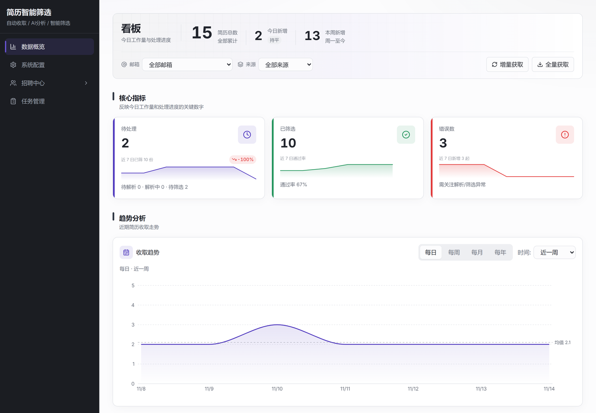
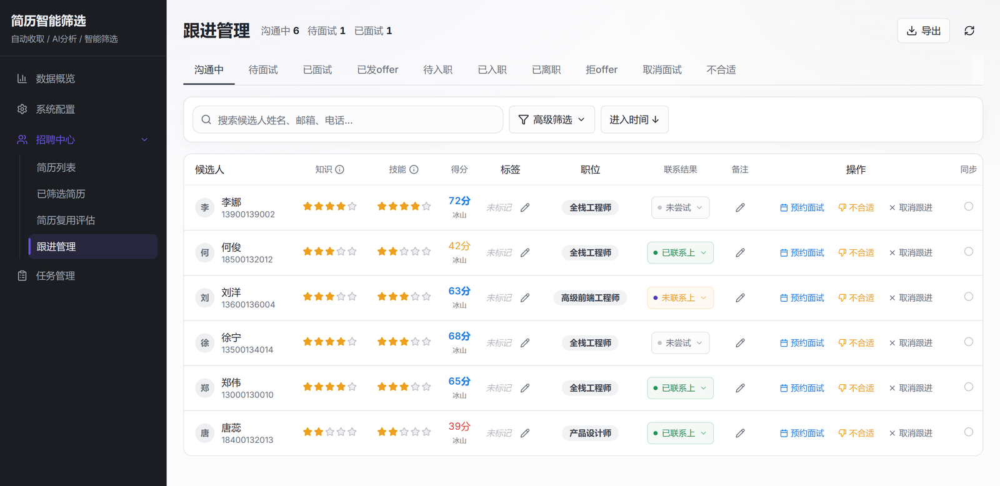

# ResumeGlacier

> **Self-hosted AI resume screening for small HR teams.**
> 自托管的 AI 简历筛选系统 · 开源 (MIT) · Node.js 单实例即可运行

[](https://github.com/learnljs/ResumeGlacier/actions/workflows/ci.yml)
[](./LICENSE)
[](https://nextjs.org)
[](https://www.typescriptlang.org)
[](https://www.prisma.io)

ResumeGlacier 通过 IMAP 自动收取邮件简历，**两级文本提取回退**保证识别率，
**冰山模型 6 维度评估**按职位独立配置，**Webhook 通用导出**对接任意下游系统。
所有数据留在你自己的服务器上，**开源、可审计、可定制**。

---

## 界面预览



<p align="center"><sub><b>数据看板</b> — 总量与今日 / 本周增量、核心指标 7 日走势、跟进流转概览</sub></p>



<p align="center"><sub><b>跟进管理</b> — 按沟通阶段分栏，评分、标签、联系结果与预约面试集中处理</sub></p>

> 截图取自内置演示数据（15 份虚构简历、3 个职位），不含任何真实候选人信息。
> 空库首次启动会自动写入同一套演示数据，按下面「快速开始」跑起来即可看到同样界面。

---

## 目录

- [界面预览](#界面预览)
- [为什么做这个](#为什么做这个)
- [核心特性](#核心特性)
- [快速开始](#快速开始)
- [环境变量](#环境变量)
- [使用指南](#使用指南)
- [架构概览](#架构概览)
- [API 文档](#api-文档)
- [数据模型](#数据模型)
- [部署](#部署)
- [贡献](#贡献)
- [许可证](#许可证)

---

## 为什么做这个

中小 HR 团队在筛选简历时普遍面临三类痛点：

- **渠道分散**：简历来自邮箱、Boss 直聘、内推等多个渠道，需要人工汇总
- **筛选标准不统一**：不同 HR 主观判断差异大，缺乏可复用的评分体系
- **合规与隐私**：简历数据敏感，不希望传到第三方 SaaS

ResumeGlacier 把整套流程落到自托管的本地系统里：

- **统一入口**：所有邮件简历走 IMAP 收取，单一来源、单一流程
- **冰山模型**：6 维度评分（知识 / 技能 / 自我认知 / 品质 / 价值观 / 动机），按职位配置权重，AI 评估 + 人工覆盖双轨
- **数据自主**：SQLite 单文件数据库，AES-256-GCM 加密敏感字段，永远不离开你的服务器
- **导出灵活**：Webhook 通用推送，下游对接企微、飞书、Slack、自建表格都可以

---

## 核心特性

### 1. IMAP 自动收取

兼容任意 IMAP 邮箱（QQ 邮箱、企业邮箱、Gmail、Outlook 等），增量 UID 追踪、`messageId` 去重；
全天候每 30 分钟自动收取，也可手动触发或控制台批量同步。

### 2. 两级文本提取（首创）

简历附件通常是 PDF/DOCX/扫描件混在一起，单一方案识别率不够。ResumeGlacier 走两级回退：

```
PDF 视觉排序提取（pdfjs-dist）
        ↓ 失败 / 质量不达标
Tesseract.js OCR（中文 + 英文）
        ↓ 全部失败
标记 ERROR，提示用户
```

5 项加权文本质量检测（可识别字符比率、CID 字体序列、Unicode 异常、有效文本密度、重复模式），
得分 < 40 自动触发 OCR 降级。

### 3. 冰山模型 6 维度评估

把候选人能力分成可见层（**知识 / 技能**）和隐藏层（**自我认知 / 品质 / 价值观 / 动机**），
每个职位独立配置权重模型，AI 自动评分 + HR 手动覆盖。

| 层级 | 维度 | 典型权重区间 |
|------|------|--------------|
| 可见 | 知识 | 30-50% |
| 可见 | 技能 | 30-50% |
| 隐藏 | 自我认知 | 0-15% |
| 隐藏 | 品质特质 | 0-15% |
| 隐藏 | 价值观 | 0-15% |
| 隐藏 | 动机 | 0-15% |

### 4. 按职位独立评估

同一份简历可以对多个职位分别评估，结果互不覆盖（`@@unique([resumeId, positionId])`）。
详情页职位下拉框切换查看不同职位的评估结果，候选人池查询支持跨职位挑人。

### 5. 提示词版本管理

每个职位的评估提示词独立维护（4 个编辑区：提示词主体 / 知识维度 / 技能维度 / 通用评分规则），
每次保存自动生成版本，支持历史查看、diff 对比、一键回滚。

### 6. 跟进状态机

10 种状态的完整状态机：

```
沟通中 → 待面试 → 已面试 → 已发 offer → 待入职 → 已入职 → 已离职
   ↓       ↓        ↓         ↓
不合适  取消面试  拒 offer  不合适
```

每个正向流转校验必填字段（面试时间、拒绝原因、入职时间、离职日期等），
支持按回退路径逐级回退（需填写回退原因，写入审计日志）。

### 7. Webhook 通用导出

跟进记录进入「待面试」及之后阶段自动触发 Webhook 推送，5 种字段转换（DIRECT / ENUM_MAP / TIMESTAMP / CONCAT / FIXED），
**不绑定任何下游平台**——企微、飞书、Slack、自建表格、甚至 webhook.site 都能对接。

### 8. 数据加密

邮箱密码、AI API Key、Webhook URL 全部使用 AES-256-GCM 加密存储（密钥来自 `ENCRYPTION_KEY`），
数据库文件本身可以放在加密磁盘上，双重保险。

---

## 快速开始

### 前置要求

- Node.js 20+ 与 npm
- 一个 OpenAI 兼容的 AI 服务（推荐 DeepSeek / 通义千问 / OpenAI / Azure OpenAI）

### 30 秒跑起来

```bash
# 1. 克隆仓库
git clone https://github.com/learnljs/ResumeGlacier.git
cd ResumeGlacier

# 2. 安装依赖
npm install

# 3. 配置环境变量（生成加密密钥）
cp .env.example .env
echo "ENCRYPTION_KEY=\"$(openssl rand -hex 32)\"" >> .env

# 4. 初始化数据库（Prisma generate + db push）
npm run db:setup

# 5. 启动开发服务器
npm run dev
```

启动后访问 [http://localhost:3000](http://localhost:3000)。

### 先看效果：演示模式

数据库是空的时候，第一次打开页面会自动写入一份**虚构的演示数据**（12 份简历、3 个职位、
6 条跟进记录、完整的评估与权重模型），不需要配置邮箱和 AI Key 就能看到看板、简历列表、
跟进看板的真实样子。

页面顶部会显示一条「演示数据」提示条，点右侧「删除演示数据」可一键清空并退出演示模式，
之后就可以接入自己的邮箱。也可以手动播种：

```bash
npm run db:demo
```

> 演示数据只写入空库；退出后不会再次自动播种。

**首次配置步骤**：

1. 进入「系统配置 → 邮箱配置」添加 IMAP 邮箱
2. 进入「系统配置 → AI 模型配置」添加 AI 模型（任意 OpenAI 兼容接口）
3. 进入「系统配置 → 职位管理」创建招聘职位
4. 进入「系统配置 → 评估提示词」按职位配置评估规则
5. 在数据概览页点击「手动收取邮件」开始接收简历

---

## 环境变量

完整配置见 [.env.example](./.env.example)。核心变量：

| 变量 | 必填 | 说明 |
|------|------|------|
| `DATABASE_URL` | 是 | SQLite 路径，默认 `file:./data/resume.db` |
| `ENCRYPTION_KEY` | 是 | 64 位十六进制字符，AES-256-GCM 密钥（生成：`openssl rand -hex 32`）。**一旦丢失无法解密历史数据** |
| `SCREENING_CONCURRENCY` | 否 | AI 筛选并发数，默认 2 |
| `PARSING_CONCURRENCY` | 否 | 解析并发数，SQLite 限制下保持 1 |
| `CRON_SECRET` | 生产 | 定时任务 API 的 Bearer token |
| `OPENAI_API_KEY` | 否 | AI 配置兜底值，推荐在管理后台配置 |
| `OPENAI_BASE_URL` | 否 | OpenAI 兼容接口地址 |
| `OPENAI_MODEL` | 否 | 模型名称 |

邮箱密码、AI Key、Webhook URL 推荐在管理后台配置，使用 `ENCRYPTION_KEY` 加密存储到数据库。

---

## 使用指南

### 邮件收取

- **定时收取**：生产环境全天候每 30 分钟自动收取一次（`0,30 * * * *`）
- **手动收取**：在数据概览页或邮件管理页点击「手动收取邮件」
- **全量同步**：使用 `npx tsx scripts/full-mailbox-sync.ts <configId>`

### 简历解析与评估

简历收取后自动进入解析队列（SQLite 写限制下并发=1），解析完成后入 AI 筛选队列。
评估结果存储在 `PositionEvaluation`，与简历原始数据解耦。

### 提示词维护

在「系统配置 → 评估提示词」按职位编辑 4 个编辑区。每次保存生成新版本，可查看历史、对比差异、一键回滚。
**保存后对未来评估立即生效**，不影响已有评估结果。

### 多职位评估

- 简历详情页顶部「职位选择器」切换查看不同职位的评估
- 同一简历可对多个职位分别评估，结果独立存储
- 候选人池查询支持跨职位复用评估结果

### 跟进管理

在已筛选简历中点击「跟进」创建跟进记录，按状态机逐级流转。
每个节点登记联系结果、面试时间、薪资范围、入职时间等。
支持批量跟进、Excel 导出、Webhook 推送。

### Webhook 集成

在「系统配置 → Webhook 集成」中：

1. 添加 Webhook URL（加密存储）
2. 按字段配置映射规则（5 种转换类型可选）
3. 导入目标系统的 schema（可选）
4. 关联职位与目标系统的字段映射

进入「待面试」及之后阶段自动触发同步，支持同步状态展示与手动重试。

---

## 架构概览

### 1. 服务器入口

- **开发环境**：`npm run dev`（webpack 注入 polyfill）
- **生产环境**：`node server.js`（自定义入口，polyfill 时序可控）
- `pdfjs-dist` v4 依赖 `process.getBuiltinModule`，需要 polyfill

### 2. 后台队列

- **解析队列**：SQLite 写限制下并发=1，启动时恢复孤儿任务
- **筛选队列**：可配置并行度，默认 2
- **Webhook 推送队列**：聚合窗口批量推送（50 条或 5 秒），失败指数退避重试
- 所有队列通过 `globalThis` 单例模式兼容 Next.js HMR

### 3. 数据流

```
IMAP 收取 (imapflow + mailparser)
        ↓
2 级文本提取 (pdfjs-dist / Tesseract)
        ↓
质量门禁 (5 项加权评分)
        ↓
AI 评估 (冰山模型 6 维度，按职位独立)
        ↓
跟进管理 (10 状态状态机)
        ↓
Webhook 推送 (5 种字段转换)
```

### 4. 定时调度

`node-cron` 实现，仅生产环境启动：

- 邮件收取：每 30 分钟（`0,30 * * * *`，Asia/Shanghai）
- 离职扫描：每日 02:00 扫描当日到期离职记录
- 日志：`data/logs/scheduler-YYYY-MM-DD.log`

---

## API 文档

API 路由按模块分组放在 `app/api/` 下，共 11 组：

| 模块 | 端点前缀 | 主要功能 |
|------|---------|---------|
| 配置 | `/api/config/*` | AI / 邮箱 / 来源 / Webhook 配置 |
| 定时任务 | `/api/cron/*` | 邮件收取、调度器管理 |
| 仪表盘 | `/api/dashboard/*` | 统计、趋势、职位对比 |
| 邮件 | `/api/emails/*` | 列表、收取、生成简历 |
| 评估 | `/api/evaluations/*` | 维度评分 CRUD |
| 跟进 | `/api/follow-up/*` | 跟进记录、标签、导出 |
| 职位 | `/api/positions/*` | 职位 CRUD、权重模型 |
| 提示词 | `/api/prompts/*` | 版本管理、diff、回滚 |
| 简历 | `/api/resumes/*` | CRUD、解析、筛选、复用 |
| 任务批次 | `/api/task-batches/*` | 批次管理 |
| Webhook | `/api/webhooks/*` | 推送手动触发 |

---

## 数据模型

16 个核心模型，详见 [prisma/schema.prisma](./prisma/schema.prisma)：

| 模型 | 用途 |
|------|------|
| `ResumeSource` | 简历来源（邮件主题匹配规则） |
| `EmailConfig` | IMAP 邮箱配置（密码加密） |
| `AIConfig` | AI 模型配置（Key 加密，按用途分类） |
| `Position` | 招聘职位 |
| `Email` | 邮件记录 |
| `TaskBatch` | 任务批次（5 种来源类型） |
| `Resume` | 简历（文本、结构化数据、照片） |
| `PositionEvaluation` | 按职位评估（分数、AI 分析、Token 用量） |
| `WeightModel` | 权重模型（initial / iceberg） |
| `EvaluationDimension` | 维度评分（1-5 星，AI / 手动） |
| `FollowUpTag` | 跟进标签（硬性 / 意向 / 自定义） |
| `FollowUpRecord` | 跟进记录（10 状态机 + Webhook 状态） |
| `FollowUpLog` | 跟进日志 |
| `FollowUpRecordTag` | 记录-标签关联 |
| `WebhookIntegration` | Webhook 字段映射配置 |
| `PromptRecord` | 评估提示词（按职位 + 版本） |

### 关键约束

- `PositionEvaluation`: `@@unique([resumeId, positionId])` — 每份简历每个职位最多一条评估
- `EvaluationDimension`: `@@unique([resumeId, positionId, dimension])` — 每个维度一条评分
- `FollowUpRecord`: `@@unique([evaluationId])` — 跟进记录挂在评估上而非简历上
- `PromptRecord`: `@@unique([positionId, version])` — 每职位版本号递增

### SQLite 三大约束

- **不支持并发写**：解析队列并发=1，PM2 用 fork 单实例
- **无迁移**：直接用 `prisma db push`，schema 变更后 `prisma generate`
- **无 ALTER COLUMN**：改字段需重建表

---

## 部署

### 本地开发

```bash
npm install              # 安装依赖
npm run db:setup         # 初始化 Prisma + 数据库
npm run dev              # 开发服务器（http://localhost:3000）
```

### 生产构建

```bash
npm install --production=false   # 安装构建所需依赖
npm run build                     # 构建产物 .next/
npm run db:setup                  # 同步数据库 schema
npm run start                     # 启动生产服务（端口 3000）
```

### PM2 守护（可选）

```bash
npm install -g pm2
npm run build
pm2 start npm --name "resume-glacier" -- run start
pm2 save
pm2 startup   # 开机自启
```

### 数据备份

| 路径 | 内容 | 备份建议 |
|------|------|----------|
| `prisma/data/resume.db` | SQLite 数据库 | **必备份** |
| `data/uploads/` | 邮件简历附件 | 建议备份 |
| `public/photos/` | 候选人照片 | 建议备份 |
| `data/logs/` | 调度器日志 | 按需 |

> ⚠️ 备份时务必同时备份 `ENCRYPTION_KEY`，否则加密字段无法恢复。

---

## 贡献

欢迎贡献代码、提 Issue、分享使用经验。详见 [CONTRIBUTING.md](./CONTRIBUTING.md)。

提交规范遵循 [Conventional Commits](https://www.conventionalcommits.org/)：

- `feat:` — 新功能
- `fix:` — 修复 bug
- `refactor:` — 重构
- `docs:` — 文档
- `style:` — 代码格式
- `perf:` — 性能优化

---

## 许可证

本项目采用 [MIT](./LICENSE) 许可证。你可以自由使用、修改、分发本项目的源代码，但需保留版权声明和许可证声明。

---

## 致谢

ResumeGlacier 在开发过程中参考了多个开源项目：

- [Next.js](https://nextjs.org) · [Prisma](https://www.prisma.io) · [Tailwind CSS](https://tailwindcss.com)
- [pdfjs-dist](https://mozilla.github.io/pdf.js/) · [tesseract.js](https://tesseract.projectnaptha.com/) · [mammoth](https://github.com/mwilliamson/mammoth.js)
- [ImapFlow](https://github.com/postalsys/imapflow) · [mailparser](https://github.com/nodemailer/mailparser)
- [node-cron](https://github.com/node-cron/node-cron) · [OpenAI SDK](https://github.com/openai/openai-node)

---

> **ResumeGlacier** — 让 AI 助力招聘，从简历海洋中精准发现人才。
> ·  ·  ·  ·
> GitHub Issues | Discussions | Wiki