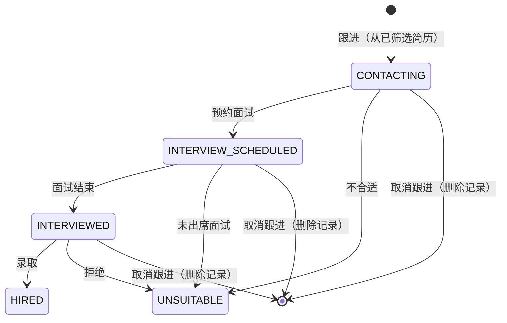

# S1 — 数据模型重构 详细规格说明

> **优先级**：P0（基础依赖，必须最先完成）
>
> **目标**：建立冰山模型评估体系的数据库基础结构，为后续所有子需求提供数据层支撑。

---

## 一、功能模块定义

S1 包含以下 5 个数据模型变更模块：

| 模块 | 类型 | 说明 |
|------|------|------|
| WeightModel 表 | 新建 | 权重模型配置表 |
| EvaluationDimension 表 | 新建 | 评估维度评分表 |
| Resume 表 | 修改 | 新增初筛得分、综合得分字段 |
| FollowUpRecord 表 | 修改 | 扩展状态枚举 + 新增字段 |
| ScreeningResult 表 | 修改 | 精简字段，删除评分相关字段 |

---

## 二、详细功能点描述

### 2.1 WeightModel 表

#### 2.1.1 表结构

```prisma
model WeightModel {
  id        String   @id @default(cuid())
  name      String                  // 模型名称
  category  String                  // "initial" | "iceberg"
  isDefault Boolean  @default(false) // 是否默认模型
  weights   String                  // JSON 字符串
  createdAt DateTime @default(now())
  updatedAt DateTime @updatedAt

  @@index([category])
}
```

#### 2.1.2 字段说明

| 字段 | 类型 | 约束 | 说明 |
|------|------|------|------|
| id | String | PK, cuid | 主键 |
| name | String | 非空 | 模型名称，如"初筛-默认模型" |
| category | String | 非空, INDEX | 模型分类：`initial`（初筛模型）或 `iceberg`（冰山模型） |
| isDefault | Boolean | 默认 false | 是否为该分类下的默认模型 |
| weights | String | 非空 | JSON 格式的权重配置 |
| createdAt | DateTime | 自动 | 创建时间 |
| updatedAt | DateTime | 自动 | 更新时间 |

#### 2.1.3 权重 JSON 结构

初筛模型（category = "initial"）：
```json
{
  "knowledge": 50,
  "skill": 50
}
```

冰山模型（category = "iceberg"）：
```json
{
  "knowledge": 15,
  "skill": 15,
  "selfAwareness": 20,
  "personality": 20,
  "values": 15,
  "motivation": 15
}
```

#### 2.1.4 业务规则

- 同一 category 下只能有一个 `isDefault = true` 的记录
- 初筛模型的 weights 必须包含 `knowledge` 和 `skill` 两个 key
- 冰山模型的 weights 必须包含全部 6 个 key：`knowledge`、`skill`、`selfAwareness`、`personality`、`values`、`motivation`
- 所有权重值必须为正整数，总和必须等于 100
- 默认模型不可删除

#### 2.1.5 预置数据

| name | category | isDefault | weights |
|------|----------|-----------|---------|
| 初筛-默认模型 | initial | true | `{"knowledge":50,"skill":50}` |
| 冰山-默认模型 | iceberg | true | `{"knowledge":15,"skill":15,"selfAwareness":20,"personality":20,"values":15,"motivation":15}` |

---

### 2.2 EvaluationDimension 表

#### 2.2.1 表结构

```prisma
model EvaluationDimension {
  id          String    @id @default(cuid())
  resumeId    String
  positionId  String?
  dimension   String
  rating      Int?
  comment     String?
  source      String
  evaluatedAt DateTime  @default(now())

  resume      Resume    @relation(fields: [resumeId], references: [id], onDelete: Cascade)
  position    Position? @relation(fields: [positionId], references: [id])

  @@unique([resumeId, positionId, dimension])
  @@index([resumeId])
  @@index([positionId])
}
```

#### 2.2.2 字段说明

| 字段 | 类型 | 约束 | 说明 |
|------|------|------|------|
| id | String | PK, cuid | 主键 |
| resumeId | String | FK, 非空 | 关联简历 ID，级联删除 |
| positionId | String? | FK, 可空 | 关联职位 ID（多职位场景） |
| dimension | String | 非空 | 维度标识：`knowledge`、`skill`、`selfAwareness`、`personality`、`values`、`motivation` |
| rating | Int? | 可空, 1-5 | 星级评分，null 表示未评分 |
| comment | String? | 可空, 最大 500 字符 | 文本评价（备注说明） |
| source | String | 非空 | 评分来源：`ai`（AI 自动评分）或 `manual`（HR 人工评估） |
| evaluatedAt | DateTime | 自动 | 评估时间 |

#### 2.2.3 业务规则

- 同一简历 + 同一职位 + 同一维度，只能有一条记录（唯一约束）
- `positionId` 为 null 时，表示该评估不关联具体职位（通用评估）
- `rating` 取值范围为 1-5，null 表示尚未评分
- `comment` 最大长度 500 字符
- `source` 仅允许 `ai` 或 `manual` 两个值
- 当关联的 Resume 被删除时，对应的 EvaluationDimension 记录级联删除
- 当关联的 Position 被删除时，`positionId` 置为 null（Position 是软删除，实际不会触发）

#### 2.2.4 维度枚举值

| dimension 值 | 中文名称 | 所属冰山层 |
|--------------|---------|-----------|
| knowledge | 知识 | 显性 |
| skill | 技能 | 显性 |
| selfAwareness | 自我认知 | 隐性 |
| personality | 品质特质 | 隐性 |
| values | 价值观 | 隐性 |
| motivation | 动机 | 隐性 |

---

### 2.3 Resume 表修改

#### 2.3.1 新增字段

```prisma
model Resume {
  // ... 现有字段保持不变 ...
  initialScore    Float?    // 初筛得分（百分制，0-100）
  compositeScore  Float?    // 综合得分（百分制，0-100）
}
```

| 字段 | 类型 | 约束 | 说明 |
|------|------|------|------|
| initialScore | Float? | 可空 | 初筛得分，百分制（0-100），由评估服务自动计算 |
| compositeScore | Float? | 可空 | 综合得分，百分制（0-100），由评估服务自动计算 |

#### 2.3.2 业务规则

- 两个字段均为可空，新创建的简历默认为 null
- 评分由评估服务（S8）自动计算并写入，不由前端直接修改
- 初筛得分 = 知识维度得分 + 技能维度得分（使用默认初筛模型权重）
- 综合得分 = 全部 6 个维度得分之和（使用默认冰山模型权重）
- 未评分的维度不计入得分（视为 0 分）

---

### 2.4 FollowUpRecord 表修改

#### 2.4.1 字段变更

```prisma
model FollowUpRecord {
  // ... 现有字段 ...
  status         String    @default("CONTACTING")  // 原默认值 "ACTIVE" → "CONTACTING"
  interviewTime  String?   // 新增：面试时间
  salaryRange    String?   // 新增：薪资范围
  startDate      String?   // 新增：入职时间
  jobLevel       String?   // 新增：岗位级别
  rejectReason   String?   // 新增：拒绝原因
}
```

#### 2.4.2 状态枚举值

| 状态值 | 中文名称 | 说明 |
|--------|---------|------|
| CONTACTING | 沟通中 | 从已筛选简历"跟进"进入 |
| INTERVIEW_SCHEDULED | 待面试 | 从沟通中"预约面试"进入 |
| INTERVIEWED | 已面试 | 从待面试"面试结束"进入 |
| HIRED | 已录用 | 从已面试"录取"进入 |
| UNSUITABLE | 不合适 | 从沟通中/待面试/已面试转入 |

#### 2.4.3 新增字段说明

| 字段 | 类型 | 说明 | 填写时机 |
|------|------|------|---------|
| interviewTime | String? | 预约面试时间 | 状态变为 INTERVIEW_SCHEDULED 时 |
| salaryRange | String? | 录用薪资范围 | 状态变为 HIRED 时 |
| startDate | String? | 预计入职时间 | 状态变为 HIRED 时 |
| jobLevel | String? | 录用岗位级别 | 状态变为 HIRED 时 |
| rejectReason | String? | 拒绝/不合适原因 | 状态变为 UNSUITABLE 时 |

#### 2.4.4 业务规则

- 状态从 `ACTIVE` 迁移为 `CONTACTING`（数据迁移脚本处理）
- 状态流转路径：
  - 已筛选简历 → CONTACTING（跟进）
  - CONTACTING → INTERVIEW_SCHEDULED（预约面试）
  - CONTACTING → UNSUITABLE（不合适）
  - INTERVIEW_SCHEDULED → INTERVIEWED（面试结束）
  - INTERVIEW_SCHEDULED → UNSUITABLE（未出席面试）
  - INTERVIEWED → HIRED（录取）
  - INTERVIEWED → UNSUITABLE（拒绝）
- 取消跟进：直接删除 FollowUpRecord 记录，简历返回已筛选列表
- HIRED 状态时 `salaryRange`、`startDate`、`jobLevel` 必填
- UNSUITABLE 状态时 `rejectReason` 必填

#### 2.4.5 状态流转图



---

### 2.5 ScreeningResult 表精简

#### 2.5.1 删除字段

| 字段 | 原类型 | 删除原因 |
|------|--------|---------|
| decision | String | 被星级评分和百分制得分替代，PASS/FAIL/UNCERTAIN 概念废弃 |
| score | Int | 被 Resume.initialScore / compositeScore 替代 |
| matchedKeywords | String? | 新评估体系不涉及关键词匹配 |
| rawOutput | String? | 原始 AI 输出文本，无保留价值 |

#### 2.5.2 保留字段

| 字段 | 类型 | 保留原因 |
|------|------|---------|
| id | String | 主键 |
| resumeId | String | 关联关系 |
| aiConfigId | String? | 记录使用的 AI 配置 |
| summary | String | AI 生成的候选人摘要，供评估参考 |
| strengths | String | AI 生成的优势分析 |
| weaknesses | String | AI 生成的劣势分析 |
| detailAnalysis | String | AI 生成的详细分析（Markdown） |
| aiModel | String | 使用的 AI 模型名称 |
| tokenUsage | Int? | Token 消耗量（成本追踪） |
| processingTime | Int? | 处理耗时（性能监控） |
| createdAt | DateTime | 创建时间 |

#### 2.5.3 业务规则

- 删除字段后，已有数据中对应列的数据将丢失（SQLite 不支持 DROP COLUMN，需要通过重建表实现）
- 保留字段的数据必须完整迁移，不能丢失
- 新流程中不再向 ScreeningResult 写入 `decision` 和 `score`（S2 改造后）

---

## 三、数据迁移

### 3.1 迁移脚本要求

迁移脚本需要按以下顺序执行：

1. **创建 WeightModel 表** + 插入两条默认数据
2. **创建 EvaluationDimension 表**
3. **修改 Resume 表** — 新增 `initialScore`、`compositeScore` 字段
4. **修改 FollowUpRecord 表** — 扩展 status 默认值 + 新增字段
5. **精简 ScreeningResult 表** — 删除字段（SQLite 需重建表）

### 3.2 SQLite 表重建策略

由于 SQLite 不支持 `ALTER TABLE ... DROP COLUMN`（3.35.0 之前版本），精简 ScreeningResult 需要：

1. 创建新表 `ScreeningResult_new`（不含要删除的字段）
2. 复制数据：`INSERT INTO ScreeningResult_new SELECT id, resumeId, aiConfigId, summary, strengths, weaknesses, detailAnalysis, aiModel, tokenUsage, processingTime, createdAt FROM ScreeningResult`
3. 删除旧表：`DROP TABLE ScreeningResult`
4. 重命名：`ALTER TABLE ScreeningResult_new RENAME TO ScreeningResult`
5. 重建索引和约束

### 3.3 FollowUpRecord 状态迁移

```sql
UPDATE FollowUpRecord SET status = 'CONTACTING' WHERE status = 'ACTIVE';
-- UNSUITABLE 保持不变
```

### 3.4 执行顺序

```bash
# 1. 执行迁移脚本
npx tsx scripts/migrate-iceberg-model.ts

# 2. 推送 schema 变更到数据库
npx prisma db push

# 3. 重新生成 Prisma 客户端
npx prisma generate
```

---

## 四、接口定义

S1 本身不涉及 API 接口，但定义了以下表结构供 S8（评分 API）和 S3（权重模型管理）使用。

### 4.1 Prisma 模型访问

迁移完成后，以下 Prisma 模型可用：

```typescript
// 新模型
prisma.weightModel.findMany()
prisma.weightModel.create({ data: { ... } })
prisma.weightModel.update({ where: { id }, data: { ... } })
prisma.weightModel.delete({ where: { id } })

prisma.evaluationDimension.findMany({ where: { resumeId } })
prisma.evaluationDimension.create({ data: { ... } })
prisma.evaluationDimension.update({ where: { id }, data: { ... } })
prisma.evaluationDimension.delete({ where: { id } })
prisma.evaluationDimension.deleteMany({ where: { resumeId } })

// 修改后的模型
prisma.resume.findUnique({ where: { id } })  // 现在包含 initialScore, compositeScore
prisma.followUpRecord.findMany({ where: { status: 'CONTACTING' } })  // 新状态值
```

---

## 五、非功能需求

### 5.1 性能要求

- `prisma db push` 执行时间不超过 30 秒（数据量 < 10,000 条时）
- 数据迁移脚本执行时间不超过 60 秒
- EvaluationDimension 表的查询性能：按 `resumeId` 查询 < 50ms

### 5.2 数据完整性

- 迁移前后数据条数必须一致（ScreeningResult 除外，删除字段不影响行数）
- 迁移后 ScreeningResult 的保留字段数据不能为 null（除非迁移前就是 null）
- 默认权重模型数据必须在迁移脚本中预置，不能遗漏

### 5.3 回滚方案

- 迁移前备份数据库文件：`cp data/resume.db data/resume.db.bak`
- 如果迁移失败，恢复备份文件后重新执行
- ScreeningResult 表重建是破坏性操作，必须在迁移前备份

---

## 六、验收标准

### 6.1 WeightModel 表

- [ ] 表创建成功，包含所有定义的字段
- [ ] `category` 字段索引创建成功
- [ ] 两条默认数据正确插入：
  - 初筛-默认模型（category: initial, isDefault: true, weights: `{"knowledge":50,"skill":50}`）
  - 冰山-默认模型（category: iceberg, isDefault: true, weights: `{"knowledge":15,"skill":15,"selfAwareness":20,"personality":20,"values":15,"motivation":15}`）
- [ ] `weights` 字段可正确存储和读取 JSON 字符串

### 6.2 EvaluationDimension 表

- [ ] 表创建成功，包含所有定义的字段
- [ ] 唯一约束 `[resumeId, positionId, dimension]` 生效
- [ ] `resumeId` 和 `positionId` 索引创建成功
- [ ] 外键关系正确：Resume 删除时级联删除 EvaluationDimension
- [ ] `rating` 字段允许 null（未评分状态）

### 6.3 Resume 表

- [ ] `initialScore` 字段添加成功，类型为 Float?
- [ ] `compositeScore` 字段添加成功，类型为 Float?
- [ ] 已有记录的新增字段默认为 null

### 6.4 FollowUpRecord 表

- [ ] `status` 字段默认值改为 `CONTACTING`
- [ ] `interviewTime`、`salaryRange`、`startDate`、`jobLevel`、`rejectReason` 字段添加成功
- [ ] 已有 `ACTIVE` 状态记录迁移为 `CONTACTING`
- [ ] 已有 `UNSUITABLE` 状态记录保持不变
- [ ] 新字段对已有记录默认为 null

### 6.5 ScreeningResult 表

- [ ] `decision` 字段已删除
- [ ] `score` 字段已删除
- [ ] `matchedKeywords` 字段已删除
- [ ] `rawOutput` 字段已删除
- [ ] 保留字段（summary, strengths, weaknesses, detailAnalysis, aiModel, tokenUsage, processingTime）数据完整
- [ ] 外键关系（resumeId → Resume, aiConfigId → AIConfig）保持正确

### 6.6 整体验证

- [ ] `npx prisma db push` 执行成功，无错误
- [ ] `npx prisma generate` 执行成功，生成新客户端
- [ ] 应用启动正常，无数据库连接错误
- [ ] 现有页面（简历列表、详情、跟进管理）在数据迁移后正常显示（使用旧字段的页面可能需要适配，但不能崩溃）
