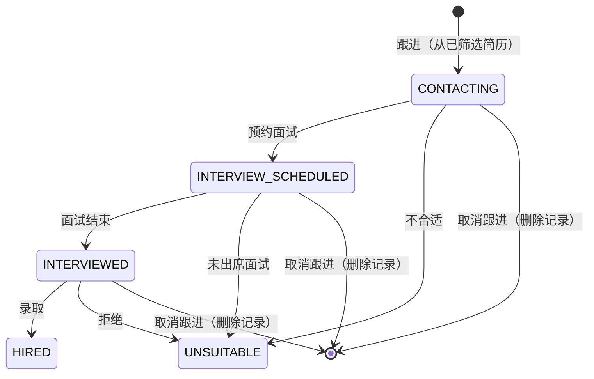

# S7 — 跟进管理页重构 详细规格说明

> **优先级**：P3（面试阶段管理）
>
> **依赖**：S1（数据模型重构）、S8（评估维度评分 API）
>
> **目标**：将跟进管理页面从单页面改造为三子页面（沟通中、待面试、已面试），支持完整的状态流转和评估操作。

---

## 一、功能模块定义

S7 包含以下 4 个模块：

| 模块 | 类型 | 说明 |
|------|------|------|
| 页面结构改造 | 修改 | 从两 Tab 改为三 Tab + 历史记录 |
| 子页面内容 | 修改 | 每个 Tab 显示对应状态的候选人列表 |
| 状态流转操作 | 修改 | 新增预约面试、面试结束、录取、拒绝等操作 |
| API 扩展 | 修改 | PATCH 支持新状态和新字段 |

---

## 二、详细功能点描述

### 2.1 页面结构改造

#### 2.1.1 文件位置

`app/resume/follow-up/page.tsx`

#### 2.1.2 现有结构

```
[跟进中] [不适合]  ← 两个 Tab
```

#### 2.1.3 改造后结构

```
[沟通中] [待面试] [已面试] [不合适] [已录用]  ← 五个 Tab
```

#### 2.1.4 Tab 定义

| Tab | 对应 FollowUpRecord.status | 说明 |
|-----|---------------------------|------|
| 沟通中 | CONTACTING | 从已筛选简历"跟进"进入 |
| 待面试 | INTERVIEW_SCHEDULED | 从沟通中"预约面试"进入 |
| 已面试 | INTERVIEWED | 从待面试"面试结束"进入 |
| 不合适 | UNSUITABLE | 从任意阶段转入 |
| 已录用 | HIRED | 从已面试"录取"进入 |

#### 2.1.5 页面顶部统计

显示各阶段候选人数量统计：

```tsx
<div className="flex gap-4 text-sm">
  <span>沟通中 (<strong>{counts.CONTACTING}</strong>)</span>
  <span>待面试 (<strong>{counts.INTERVIEW_SCHEDULED}</strong>)</span>
  <span>已面试 (<strong>{counts.INTERVIEWED}</strong>)</span>
</div>
```

统计数据从 `GET /api/follow-up/records` 响应中获取，或单独调用统计接口。

---

### 2.2 沟通中子页面

#### 2.2.1 列表列

| 列 | 说明 |
|-----|------|
| 候选人 | candidateName + phone/email |
| 知识 | 星级评分（可编辑） |
| 技能 | 星级评分（可编辑） |
| 初筛得分 | 百分制（自动计算） |
| 职位 | position.title |
| 操作 | 查看、预约面试、不合适、取消跟进 |

#### 2.2.2 操作按钮

| 按钮 | 行为 |
|------|------|
| 查看详情 | 跳转到 `/resume/detail/[id]?from=contacting` |
| 预约面试 | PATCH 状态为 INTERVIEW_SCHEDULED，设置 interviewTime |
| 不合适 | 弹窗填写拒绝原因，PATCH 状态为 UNSUITABLE |
| 取消跟进 | DELETE FollowUpRecord，简历返回已筛选列表 |

#### 2.2.3 预约面试弹窗

```
┌─────────────────────────────────┐
│  预约面试                        │
├─────────────────────────────────┤
│  面试时间: [日期时间选择器]       │
│                                 │
│            [取消] [确认预约]     │
└─────────────────────────────────┘
```

确认后调用：
```typescript
PATCH /api/follow-up/records/[id]
Body: { status: 'INTERVIEW_SCHEDULED', interviewTime: '2024-01-15 14:00' }
```

#### 2.2.4 内联编辑

知识、技能星级可直接修改，使用 S5 中创建的 `StarRating` 组件。

---

### 2.3 待面试子页面

#### 2.3.1 列表列

| 列 | 说明 |
|-----|------|
| 候选人 | candidateName + phone/email |
| 知识 | 星级评分（可编辑） |
| 技能 | 星级评分（可编辑） |
| 初筛/综合得分 | 自动选择模型计算 |
| 面试时间 | interviewTime |
| 职位 | position.title |
| 标签 | 可编辑标签 |
| 操作 | 查看、面试结束、未出席 |

#### 2.3.2 模型自动选择逻辑

```typescript
const knowledgeRated = evaluations.some(e => e.dimension === 'knowledge' && e.rating !== null)
const skillRated = evaluations.some(e => e.dimension === 'skill' && e.rating !== null)
const allRated = ['knowledge', 'skill', 'selfAwareness', 'personality', 'values', 'motivation']
  .every(dim => evaluations.some(e => e.dimension === dim && e.rating !== null))

if (allRated) {
  // 使用冰山模型，显示综合得分
  scoreType = 'composite'
  score = compositeScore
} else if (knowledgeRated && skillRated) {
  // 使用初筛模型，显示初筛得分
  scoreType = 'initial'
  score = initialScore
} else {
  scoreType = 'none'
  score = null
}
```

#### 2.3.3 操作按钮

| 按钮 | 行为 |
|------|------|
| 查看详情 | 跳转到 `/resume/detail/[id]?from=interview-scheduled` |
| 面试结束 | PATCH 状态为 INTERVIEWED |
| 未出席面试 | 弹窗填写拒绝原因，PATCH 状态为 UNSUITABLE |

---

### 2.4 已面试子页面

#### 2.4.1 列表列

| 列 | 说明 |
|-----|------|
| 候选人 | candidateName + phone/email |
| 知识 | 星级评分（可编辑） |
| 技能 | 星级评分（可编辑） |
| 自我认知 | 星级评分（可编辑） |
| 品质特质 | 星级评分（可编辑） |
| 价值观 | 星级评分（可编辑） |
| 动机 | 星级评分（可编辑） |
| 综合得分 | 冰山模型计算 |
| 面试时间 | interviewTime |
| 职位 | position.title |
| 标签 | 可编辑标签 |
| 操作 | 查看、录取、拒绝 |

#### 2.4.2 操作按钮

| 按钮 | 行为 |
|------|------|
| 查看详情 | 跳转到 `/resume/detail/[id]?from=interviewed` |
| 录取 | 弹窗填写薪资/入职时间/岗位级别，PATCH 状态为 HIRED |
| 拒绝 | 弹窗填写拒绝原因，PATCH 状态为 UNSUITABLE |

#### 2.4.3 录取弹窗

```
┌─────────────────────────────────┐
│  录取                            │
├─────────────────────────────────┤
│  薪资范围: [______________]      │
│  入职时间: [日期选择器]          │
│  岗位级别: [______________]      │
│                                 │
│            [取消] [确认录取]     │
└─────────────────────────────────┘
```

确认后调用：
```typescript
PATCH /api/follow-up/records/[id]
Body: { status: 'HIRED', salaryRange: '15-20K', startDate: '2024-02-01', jobLevel: 'P6' }
```

#### 2.4.4 拒绝弹窗

```
┌─────────────────────────────────┐
│  拒绝                            │
├─────────────────────────────────┤
│  拒绝原因:                       │
│  ┌─────────────────────────────┐│
│  │                             ││
│  └─────────────────────────────┘│
│                                 │
│            [取消] [确认拒绝]     │
└─────────────────────────────────┘
```

确认后调用：
```typescript
PATCH /api/follow-up/records/[id]
Body: { status: 'UNSUITABLE', rejectReason: '技术能力不匹配' }
```

---

### 2.5 不合适和已录用 Tab

#### 2.5.1 不合适 Tab

显示所有 `status = UNSUITABLE` 的记录，列表列：
- 候选人信息
- 职位
- 拒绝原因（rejectReason）
- 操作时间
- 操作：查看详情

#### 2.5.2 已录用 Tab

显示所有 `status = HIRED` 的记录，列表列：
- 候选人信息
- 职位
- 薪资范围
- 入职时间
- 岗位级别
- 操作：查看详情

---

### 2.6 日志查看功能

保留现有的日志查看功能：
- 双击行打开日志抽屉
- 显示 FollowUpLog 时间线
- 包含所有状态变更记录

---

### 2.7 API 变更

#### 2.7.1 PATCH /api/follow-up/records/[id]

**现有逻辑**：
```typescript
// 只支持 ACTIVE 和 UNSUITABLE
const validStatuses = ['ACTIVE', 'UNSUITABLE']
```

**修改为**：
```typescript
// 支持新状态
const validStatuses = ['CONTACTING', 'INTERVIEW_SCHEDULED', 'INTERVIEWED', 'HIRED', 'UNSUITABLE']
```

**新增字段支持**：

```typescript
const { status, interviewTime, salaryRange, startDate, jobLevel, rejectReason } = body

// 构建更新数据
const data: Record<string, unknown> = {}
if (status) data.status = status
if (interviewTime !== undefined) data.interviewTime = interviewTime
if (salaryRange !== undefined) data.salaryRange = salaryRange
if (startDate !== undefined) data.startDate = startDate
if (jobLevel !== undefined) data.jobLevel = jobLevel
if (rejectReason !== undefined) data.rejectReason = rejectReason
```

**状态中文标签映射**：

```typescript
const STATUS_CN: Record<string, string> = {
  CONTACTING: '沟通中',
  INTERVIEW_SCHEDULED: '待面试',
  INTERVIEWED: '已面试',
  HIRED: '已录用',
  UNSUITABLE: '不合适',
}
```

**日志记录**：

每次状态变更记录详细的中文日志：
```typescript
const detail = `状态变更: ${STATUS_CN[oldStatus]} → ${STATUS_CN[status]}`
// 如果有额外信息，追加
if (interviewTime) detail += `\n面试时间: ${interviewTime}`
if (rejectReason) detail += `\n拒绝原因: ${rejectReason}`
if (salaryRange) detail += `\n薪资范围: ${salaryRange}`
```

#### 2.7.2 GET /api/follow-up/records

**新增筛选参数**：

```
recordStatus=CONTACTING|INTERVIEW_SCHEDULED|INTERVIEWED|HIRED|UNSUITABLE
```

替代现有的 `recordTab=active|unsuitable` 参数。

#### 2.7.3 POST /api/follow-up/records

**修改默认状态**：

从已筛选简历"跟进"时，默认状态改为 `CONTACTING`（替代 `ACTIVE`）。

---

## 三、数据字段说明

### 3.1 FollowUpRecord 新增字段

| 字段 | 类型 | 说明 | 填写时机 |
|------|------|------|---------|
| interviewTime | String? | 预约面试时间 | 状态变为 INTERVIEW_SCHEDULED 时 |
| salaryRange | String? | 录用薪资范围 | 状态变为 HIRED 时 |
| startDate | String? | 预计入职时间 | 状态变为 HIRED 时 |
| jobLevel | String? | 录用岗位级别 | 状态变为 HIRED 时 |
| rejectReason | String? | 拒绝/不合适原因 | 状态变为 UNSUITABLE 时 |

### 3.2 状态枚举

| 状态值 | 中文名称 | 说明 |
|--------|---------|------|
| CONTACTING | 沟通中 | 从已筛选简历"跟进"进入 |
| INTERVIEW_SCHEDULED | 待面试 | 从沟通中"预约面试"进入 |
| INTERVIEWED | 已面试 | 从待面试"面试结束"进入 |
| HIRED | 已录用 | 从已面试"录取"进入 |
| UNSUITABLE | 不合适 | 从任意阶段转入 |

### 3.3 状态流转图



---

## 四、业务规则汇总

| 编号 | 规则 | 实现位置 |
|------|------|---------|
| BR7.1 | 三个子页面按状态分 Tab 显示 | 页面结构 |
| BR7.2 | 页面顶部显示各阶段数量统计 | 统计区域 |
| BR7.3 | 沟通中：预约面试需填写面试时间 | 预约面试弹窗 |
| BR7.4 | 沟通中：不合适需填写拒绝原因 | 不合适弹窗 |
| BR7.5 | 沟通中：取消跟进删除记录 | DELETE 操作 |
| BR7.6 | 待面试：面试结束变更状态 | PATCH 操作 |
| BR7.7 | 待面试：未出席面试需填写拒绝原因 | 弹窗 + PATCH |
| BR7.8 | 待面试：模型自动选择（初筛/冰山） | 得分显示逻辑 |
| BR7.9 | 已面试：录取需填写薪资/入职时间/岗位级别 | 录取弹窗 |
| BR7.10 | 已面试：拒绝需填写拒绝原因 | 拒绝弹窗 |
| BR7.11 | 所有子页面支持查看详情 | 链接跳转 |
| BR7.12 | 日志查看功能保留 | 日志抽屉 |

---

## 五、非功能需求

### 5.1 性能要求

- Tab 切换响应时间 < 200ms
- 状态变更操作响应时间 < 500ms
- 列表加载时间 < 1s

### 5.2 UI/UX 要求

- 使用项目统一的 UI 组件（`@/components/ui/*`）
- 使用 `sonner` toast 显示操作结果
- 弹窗居中显示，背景遮罩
- Tab 切换无页面闪烁

---

## 六、验收标准

### 6.1 页面结构

- [ ] 五个 Tab 正确显示（沟通中、待面试、已面试、不合适、已录用）
- [ ] Tab 切换正常，URL 参数同步
- [ ] 页面顶部显示各阶段数量统计

### 6.2 沟通中

- [ ] 列表显示候选人信息、知识/技能星级、初筛得分、职位
- [ ] 知识/技能星级可内联编辑
- [ ] "预约面试"弹窗正常，填写面试时间后状态变更
- [ ] "不合适"弹窗正常，填写拒绝原因后状态变更
- [ ] "取消跟进"删除记录，简历返回已筛选列表
- [ ] "查看详情"跳转正确（?from=contacting）

### 6.3 待面试

- [ ] 列表显示候选人信息、星级、得分、面试时间、职位、标签
- [ ] 模型自动选择逻辑正确（初筛/冰山）
- [ ] "面试结束"操作正常
- [ ] "未出席面试"弹窗正常，填写拒绝原因后状态变更
- [ ] "查看详情"跳转正确（?from=interview-scheduled）

### 6.4 已面试

- [ ] 列表显示 6 维度星级、综合得分、面试时间、职位、标签
- [ ] "录取"弹窗正常，填写薪资/入职时间/岗位级别后状态变更
- [ ] "拒绝"弹窗正常，填写拒绝原因后状态变更
- [ ] "查看详情"跳转正确（?from=interviewed）

### 6.5 不合适/已录用

- [ ] 不合适 Tab 显示所有 UNSUITABLE 记录，含拒绝原因
- [ ] 已录用 Tab 显示所有 HIRED 记录，含薪资/入职时间/岗位级别

### 6.6 日志

- [ ] 双击行打开日志抽屉
- [ ] 日志显示所有状态变更记录
- [ ] 日志包含中文详情（状态名称、面试时间、拒绝原因等）
