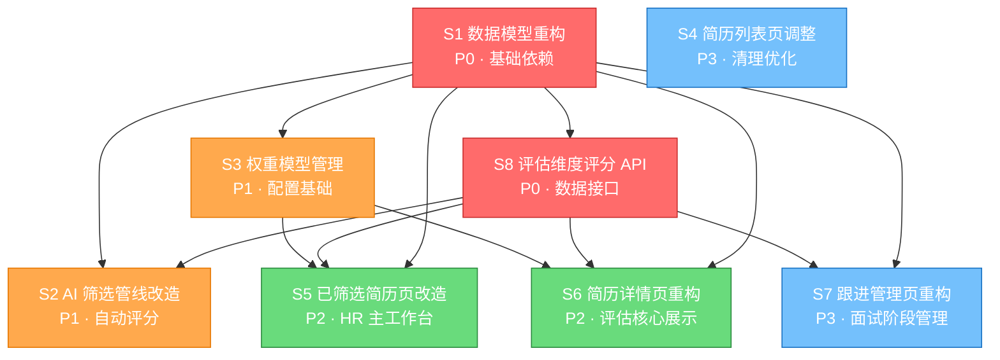

# 冰山模型评估体系 — 开发规划文档

## 一、需求总览

将现有单一维度的 AI 筛选评分体系，重构为基于冰山模型的多维度评估体系。引入 6 个评估维度（知识、技能、自我认知、品质特质、价值观、动机）、权重模型管理、星级评分（1-5星）、两种百分制得分（初筛得分、综合得分），并重构跟进管理的状态流转。

### 核心变更点

| 变更项 | 现状 | 目标 |
|--------|------|------|
| 评分维度 | 单一分数（0-100） | 6 个维度，星级评分（1-5星） |
| 得分类型 | 1 种（AI 筛选分） | 2 种（初筛得分 + 综合得分） |
| 评分来源 | 纯 AI 自动评分 | AI 自动评分（知识/技能）+ HR 人工评估 |
| 权重配置 | 无 | 多权重模型，按分类管理 |
| 跟进状态 | ACTIVE / UNSUITABLE | 沟通中 / 待面试 / 已面试 / 已录用 / 不合适 |
| 详情页 | AI 分析结果 Tab | 评估结果 Tab（雷达图 + 权重模型） |

---

## 二、设计决策记录

以下为开发规划过程中确认的关键决策：

1. **数据模型**：新建 `WeightModel` 和 `EvaluationDimension` 表，废弃 `ScreeningResult` 中的评分相关字段
2. **AI 管线改造**：修改 AI prompt 输出知识/技能两个维度的星级评分（1-5星），替代原有单一分数
3. **跟进状态扩展**：`ACTIVE` → `CONTACTING`，新增 `INTERVIEW_SCHEDULED`、`INTERVIEWED`、`HIRED` 状态
4. **取消跟进**：直接删除 `FollowUpRecord`，简历返回已筛选列表
5. **详情页改造**：保留现有 Tab 结构，"AI 分析结果"改为"评估结果"，移除"模型输出"Tab
6. **权限控制**：通过 URL 参数 `from` 传递来源列表，控制维度编辑权限
7. **雷达图**：使用 `recharts` 库实现
8. **ScreeningResult 字段精简**：删除 `decision`、`score`、`matchedKeywords`、`rawOutput`；保留 `summary`、`strengths`、`weaknesses`、`detailAnalysis` 作为 AI 参考分析
9. **AI 参考分析展示**：评估结果 Tab 底部以"AI 参考分析"区域展示保留的 AI 分析内容

---

## 三、子需求拆分与优先级

### 优先级排序

| 优先级 | 编号 | 子需求 | 预估工作量 | 依赖 |
|--------|------|--------|-----------|------|
| P0 | S1 | 数据模型重构 | 中 | 无 |
| P0 | S8 | 评估维度评分 API | 中 | S1 |
| P1 | S2 | AI 筛选管线改造 | 中 | S1, S8 |
| P1 | S3 | 权重模型管理 | 中 | S1 |
| P2 | S5 | 已筛选简历页改造 | 大 | S1, S8, S3 |
| P2 | S6 | 简历详情页重构 | 大 | S1, S8, S3 |
| P3 | S7 | 跟进管理页重构 | 大 | S1, S8 |
| P3 | S4 | 简历列表页调整 | 小 | 无 |

---

## 四、子需求详细设计

---

### S1 — 数据模型重构

**优先级**：P0（基础依赖，必须最先完成）

**目标**：建立冰山模型评估体系的数据库基础结构。

#### 1. 新增 WeightModel 表

```prisma
model WeightModel {
  id          String   @id @default(cuid())
  name        String                  // 模型名称
  category    String                  // "initial"（初筛模型）或 "iceberg"（冰山模型）
  isDefault   Boolean  @default(false) // 是否默认模型
  weights     String                  // JSON: {"knowledge": 50, "skill": 50, ...}
  createdAt   DateTime @default(now())
  updatedAt   DateTime @updatedAt

  @@index([category])
}
```

**权重 JSON 结构**：
- 初筛模型：`{"knowledge": 50, "skill": 50}`
- 冰山模型：`{"knowledge": 15, "skill": 15, "selfAwareness": 20, "personality": 20, "values": 15, "motivation": 15}`

#### 2. 新增 EvaluationDimension 表

```prisma
model EvaluationDimension {
  id          String   @id @default(cuid())
  resumeId    String
  positionId  String?                  // 关联职位（多职位场景）
  dimension   String                  // "knowledge" | "skill" | "selfAwareness" | "personality" | "values" | "motivation"
  rating      Int?                    // 星级评分 1-5，null 表示未评分
  comment     String?                 // 文本评价（最大500字符）
  source      String                  // "ai" | "manual"（AI 自动评分 或 HR 人工评估）
  evaluatedAt DateTime @default(now())

  resume      Resume   @relation(fields: [resumeId], references: [id], onDelete: Cascade)
  position    Position? @relation(fields: [positionId], references: [id])

  @@unique([resumeId, positionId, dimension])
  @@index([resumeId])
  @@index([positionId])
}
```

#### 3. 修改 Resume 表

```prisma
model Resume {
  // ... 现有字段保持不变 ...
  // 新增字段：
  initialScore    Float?    // 初筛得分（百分制，计算得出）
  compositeScore  Float?    // 综合得分（百分制，计算得出）
}
```

#### 4. 修改 FollowUpRecord 表

```prisma
model FollowUpRecord {
  // ... 现有字段 ...
  // 修改：status 字段扩展枚举值
  // "CONTACTING" | "INTERVIEW_SCHEDULED" | "INTERVIEWED" | "HIRED" | "UNSUITABLE"
  status      String    @default("CONTACTING")

  // 新增字段：
  interviewTime  String?    // 面试时间
  salaryRange    String?    // 薪资范围（录取时填写）
  startDate      String?    // 入职时间（录取时填写）
  jobLevel       String?    // 岗位级别（录取时填写）
  rejectReason   String?    // 拒绝原因（不合适时填写）
}
```

#### 5. 精简 ScreeningResult 表

删除以下字段：
- `decision` — 被星级评分和百分制得分替代
- `score` — 被初筛得分/综合得分替代
- `matchedKeywords` — 新评估体系不涉及
- `rawOutput` — 原始输出文本，无保留价值

保留以下字段（作为 AI 参考分析）：
- `resumeId`、`aiConfigId` — 关联关系
- `summary` — 候选人摘要
- `strengths` — 优势分析
- `weaknesses` — 劣势分析
- `detailAnalysis` — 详细分析
- `aiModel`、`tokenUsage`、`processingTime` — 元数据

#### 6. 数据迁移

- `FollowUpRecord` 状态迁移脚本：`ACTIVE` → `CONTACTING`，`UNSUITABLE` 不变
- 预置两个默认权重模型：
  - 初筛-默认模型（category: initial, 知识50%/技能50%, isDefault: true）
  - 冰山-默认模型（category: iceberg, 知识15%/技能15%/自我认知20%/品质特质20%/价值观15%/动机15%, isDefault: true）

#### 7. 验收标准

- [ ] WeightModel 表创建成功，默认模型数据已预置
- [ ] EvaluationDimension 表创建成功，唯一约束生效
- [ ] Resume 表新增 initialScore、compositeScore 字段
- [ ] FollowUpRecord.status 枚举值扩展，已有数据迁移完成
- [ ] ScreeningResult 精简字段删除，保留字段数据完整
- [ ] `npx prisma db push` 执行成功，`npx prisma generate` 生成新客户端

---

### S8 — 评估维度评分 API

**优先级**：P0（前端页面的数据基础）

**目标**：提供评估维度的读写接口和得分计算服务。

#### 1. 新增 API 路由

| 方法 | 路径 | 说明 |
|------|------|------|
| GET | `/api/evaluations` | 获取指定简历的评估维度数据（支持 positionId 筛选） |
| POST | `/api/evaluations` | 批量保存评估维度评分（星级 + 文本评价） |
| GET | `/api/evaluations/score` | 计算指定简历在指定权重模型下的得分 |

#### 2. 得分计算逻辑

```
维度得分 = 星级评分 × (该模型该维度权重 ÷ 5)
百分制得分 = 所有维度得分之和
```

- 初筛得分：仅计算知识 + 技能两个维度，使用初筛模型权重
- 综合得分：计算全部 6 个维度，使用冰山模型权重

#### 3. 服务层

新建 `lib/services/evaluation-service.ts`：
- `getEvaluations(resumeId, positionId?)` — 获取评估维度列表
- `saveEvaluations(resumeId, positionId, dimensions[])` — 批量保存评分
- `calculateScore(resumeId, weightModelId)` — 计算得分
- `autoCalculateScores(resumeId)` — 自动用默认模型计算初筛/综合得分并更新 Resume 表

#### 4. 验收标准

- [ ] GET `/api/evaluations` 返回指定简历的所有维度评分
- [ ] POST `/api/evaluations` 正确保存星级和文本评价，自动触发得分重算
- [ ] GET `/api/evaluations/score` 返回正确的百分制得分
- [ ] 得分计算公式正确，边界值处理合理（未评分维度不计入）
- [ ] 保存评分后自动更新 Resume 表的 initialScore 和 compositeScore

---

### S2 — AI 筛选管线改造

**优先级**：P1（让新简历自动进入评估流程）

**目标**：修改 AI 筛选管线，输出知识/技能两个维度的星级评分，替代原有单一分数。

#### 1. 修改 AI Prompt

修改 `lib/prompts/screening.ts`，将输出格式从：

```json
{
  "decision": "PASS | FAIL | UNCERTAIN",
  "score": 0-100,
  "summary": "...",
  "strengths": ["..."],
  "weaknesses": ["..."],
  "detailAnalysis": "...",
  "matchedKeywords": ["..."]
}
```

改为：

```json
{
  "knowledge": 1-5,
  "skill": 1-5,
  "summary": "...",
  "strengths": ["..."],
  "weaknesses": ["..."],
  "detailAnalysis": "..."
}
```

- `knowledge`：知识维度星级（1-5），基于简历内容评估候选人的行业知识、专业理论水平
- `skill`：技能维度星级（1-5），基于简历内容评估候选人的具体工作技能
- 有职位时，根据职位要求评估；无职位时，做通用评估

#### 2. 修改筛选服务

修改 `lib/services/ai-screener.ts`：
- 解析 AI 输出为知识/技能星级
- 创建 `EvaluationDimension` 记录（source: "ai"）
- 调用 `autoCalculateScores()` 计算初筛得分
- 更新 Resume 状态为 PASSED（不再使用 FAILED 概念，所有通过 AI 评分的简历都进入已筛选列表）
- 保留 `summary`、`strengths`、`weaknesses`、`detailAnalysis` 写入 ScreeningResult

#### 3. 修改状态流转

- AI 评分完成后，简历状态统一变为 `PASSED`（不再区分 PASS/FAIL）
- 所有通过 AI 评分的简历自动进入已筛选列表
- 移除 `FAILED` 状态的使用（现有 FAILED 记录保留，但新流程不再产生）

#### 4. 验收标准

- [ ] AI prompt 输出格式符合新规范（knowledge、skill 星级）
- [ ] 筛选完成后正确创建 EvaluationDimension 记录
- [ ] 初筛得分正确计算并写入 Resume.initialScore
- [ ] AI 参考分析（summary 等）正确写入 ScreeningResult
- [ ] 无职位匹配时，AI 仍能进行通用评估（质量可接受）
- [ ] 简历状态统一变为 PASSED，自动出现在已筛选列表

---

### S3 — 权重模型管理

**优先级**：P1（列表和详情页的数据基础）

**目标**：提供权重模型的 CRUD 管理页面。

#### 1. 新增页面

- 路径：`/resume/system-config/weight-models`
- 在系统配置侧边栏中添加"权重模型"导航项

#### 2. 页面功能

- **模型列表**：显示所有权重模型（名称、分类、包含维度、是否默认、创建时间）
- **创建模型**：弹窗表单
  - 输入模型名称
  - 选择分类（初筛模型/冰山模型）：
    - 初筛模型 → 自动锁定知识、技能两个维度
    - 冰山模型 → 自动锁定全部 6 个维度
  - 为每个维度设置权重（整数，1-100）
  - 实时显示权重总和，必须为 100% 才能保存
- **编辑模型**：同创建表单，预填现有数据
- **删除模型**：确认后删除（默认模型不可删除）

#### 3. API 路由

| 方法 | 路径 | 说明 |
|------|------|------|
| GET | `/api/config/weight-models` | 列表（支持按分类筛选） |
| POST | `/api/config/weight-models` | 创建模型 |
| GET | `/api/config/weight-models/[id]` | 获取单个模型 |
| PUT | `/api/config/weight-models/[id]` | 更新模型 |
| DELETE | `/api/config/weight-models/[id]` | 删除模型（默认模型禁止删除） |

#### 4. 验收标准

- [ ] 页面正常展示所有权重模型
- [ ] 创建模型时分类选择正确锁定维度
- [ ] 权重总和校验：不等于 100% 时禁止保存
- [ ] 默认模型显示"默认"标识，不可删除
- [ ] 编辑模型后，使用该模型的得分实时更新
- [ ] 侧边栏导航中显示"权重模型"入口

---

### S5 — 已筛选简历页改造

**优先级**：P2（HR 主工作台，业务价值最高）

**目标**：将已筛选简历页面改造为显示星级评分和初筛得分，支持内联编辑。

#### 1. 列表展示改造

**现有列** → **改造后列**：

| 现有列 | 改造后 |
|--------|--------|
| 候选人信息 | 候选人信息（不变） |
| 职位 | 职位（不变） |
| 来源 | 来源（不变） |
| 评分（AI 分数） | **知识维度**（星级展示）、**技能维度**（星级展示）、**初筛得分**（百分制） |
| 状态 | 评估时间 |
| 筛选时间 | — |
| 操作 | 操作（查看详情、跟进） |

#### 2. 星级评分内联编辑

- 知识、技能维度的星级评分在列表中可直接点击修改
- 点击弹出星级选择组件（1-5星）
- 修改后自动重新计算初筛得分
- 使用默认初筛模型计算

#### 3. 操作按钮

- "查看详情"：进入简历详情页（`?from=screened`）
- "跟进"：创建 FollowUpRecord（status: CONTACTING），简历从列表中消失

#### 4. 验收标准

- [ ] 列表正确显示知识、技能星级和初筛得分
- [ ] 点击星级可直接修改，修改后得分自动重算
- [ ] "查看详情"正确跳转到详情页，权限为仅知识/技能可编辑
- [ ] "跟进"操作正确创建跟进记录，简历从已筛选列表消失
- [ ] 排序支持按初筛得分排序

---

### S6 — 简历详情页重构

**优先级**：P2（评估的核心展示页面）

**目标**：将详情页的"AI 分析结果"Tab 改造为"评估结果"Tab，集成雷达图、权重模型选择和得分计算。

#### 1. Tab 结构变更

| 原 Tab | 改造后 |
|--------|--------|
| AI 分析结果 | **评估结果**（内容完全替换） |
| 结构化数据 | 结构化数据（不变） |
| 模型输出 | **移除** |
| 简历内容 | 简历内容（不变） |
| 邮件信息 | 邮件信息（不变） |
| 异常信息 | 异常信息（不变） |

#### 2. 评估结果 Tab 布局

**顶部 — 职位选择区域**：
- 下拉选择框：显示该简历投递的所有职位
- 切换后，评估数据实时更新
- 仅一个职位时，直接显示职位名称，不显示选择框

**左侧 — 六边形雷达图**：
- 使用 `recharts` 的 `RadarChart` 组件
- 6 个顶点：知识、技能、自我认知、品质特质、价值观、动机
- 知识和技能维度位于相邻顶点
- 已评分维度显示实际颜色和数值，未评分维度显示灰色
- 点击维度顶点或标签弹出评分组件（星级 + 文本评价）

**右侧 — 权重模型选择和得分计算**：
- 下拉选择框：显示所有权重模型（按分类分组）
- 切换后实时重新计算得分
- 展示当前模型的各维度权重配置
- 展示每个维度的得分 = 星级评分 × (权重 ÷ 5)
- 展示总分（百分制）
- 展示评分修改时间

**底部 — AI 参考分析**（如有 ScreeningResult 数据）：
- 候选人摘要
- 优势分析
- 劣势分析
- 详细分析（Markdown 渲染）

#### 3. 评分权限控制

通过 URL 参数 `from` 控制：

| from 值 | 可编辑维度 | 只读维度 |
|---------|-----------|---------|
| `screened` | 知识、技能 | 自我认知、品质特质、价值观、动机 |
| `contacting` | 知识、技能 | 自我认知、品质特质、价值观、动机 |
| `interview-scheduled` | 全部 6 个维度 | 无 |
| `interviewed` | 全部 6 个维度 | 无 |
| 无参数（默认） | 知识、技能 | 其余只读 |

- 只读维度：灰色星级图标，点击无响应
- 可编辑维度：彩色星级图标，点击弹出评分组件

#### 4. 评分组件

每个维度的评分交互：
- 星级选择：1-5星，支持点击选择
- 文本评价：输入框，最大 500 字符
- 保存时调用 POST `/api/evaluations`
- 保存后自动刷新雷达图和得分

#### 5. 验收标准

- [ ] "评估结果"Tab 正确展示雷达图、权重模型、得分计算
- [ ] 雷达图 6 个维度正确渲染，知识和技能相邻
- [ ] 点击雷达图维度可弹出评分组件
- [ ] 权重模型切换后得分实时更新
- [ ] 权限控制正确：from=screened 时只有知识/技能可编辑
- [ ] from=interview-scheduled 时全部 6 个维度可编辑
- [ ] 只读维度显示灰色，可编辑维度显示彩色
- [ ] 文本评价正常保存和展示
- [ ] AI 参考分析在底部正确展示
- [ ] "模型输出"Tab 已移除
- [ ] 多职位场景下切换职位数据正确更新

---

### S7 — 跟进管理页重构

**优先级**：P3（面试阶段管理）

**目标**：将跟进管理页面从单页面改造为三子页面（沟通中、待面试、已面试），支持完整的状态流转。

#### 1. 页面结构改造

**现有**：单页面，两个 Tab（跟进中 / 不适合）

**改造后**：三个子 Tab（标签页形式）

| 子页面 | 对应状态 | 候选人来源 |
|--------|---------|-----------|
| 沟通中 | CONTACTING | 从已筛选简历"跟进"进入 |
| 待面试 | INTERVIEW_SCHEDULED | 从沟通中"预约面试"进入 |
| 已面试 | INTERVIEWED | 从待面试"面试结束"进入 |

页面顶部显示各阶段候选人数量统计。

#### 2. 沟通中子页面

**列表列**：候选人信息、知识/技能星级评分、初筛得分、职位、操作

**操作按钮**：
- "查看详情"：进入详情页（`?from=contacting`）
- "预约面试"：状态变为 INTERVIEW_SCHEDULED
- "不合适"：状态变为 UNSUITABLE，需填写拒绝原因
- "取消跟进"：删除 FollowUpRecord，简历返回已筛选列表

**内联编辑**：知识、技能星级可直接修改，修改后自动重算初筛得分

#### 3. 待面试子页面

**列表列**：候选人信息、知识/技能星级评分、初筛得分、面试时间、职位、标签、操作

**模型自动选择逻辑**：
- 仅知识、技能有评分 → 使用初筛模型，显示初筛得分
- 6 个维度均有评分 → 使用冰山模型，显示综合得分

**操作按钮**：
- "查看详情"：进入详情页（`?from=interview-scheduled`）
- "面试结束"：状态变为 INTERVIEWED
- "未出席面试"：状态变为 UNSUITABLE，需填写拒绝原因

#### 4. 已面试子页面

**列表列**：候选人信息、6 维度星级评分、综合得分、面试时间、职位、标签、操作

**操作按钮**：
- "查看详情"：进入详情页（`?from=interviewed`）
- "录取"：状态变为 HIRED，需填写薪资范围、入职时间、岗位级别
- "拒绝"：状态变为 UNSUITABLE，需填写拒绝原因

#### 5. 不合适处理

- "不合适"操作统一弹出确认对话框，要求填写拒绝原因
- 拒绝原因写入 FollowUpRecord.rejectReason
- 状态变为 UNSUITABLE

#### 6. 已录用/不合适记录查看

- 在跟进管理页面底部或单独 Tab 中，可查看已录用和不合适的候选人历史记录
- 保留现有的日志查看功能（双击行打开日志抽屉）

#### 7. API 变更

修改 `PATCH /api/follow-up/records/[id]`：
- 支持新的状态值：CONTACTING、INTERVIEW_SCHEDULED、INTERVIEWED、HIRED、UNSUITABLE
- 支持设置 interviewTime、salaryRange、startDate、jobLevel、rejectReason 字段

#### 8. 验收标准

- [ ] 三个子页面正确展示，标签页切换正常
- [ ] 页面顶部显示各阶段候选人数量统计
- [ ] 沟通中：跟进、预约面试、不合适、取消跟进操作正确
- [ ] 待面试：面试结束、未出席面试操作正确，模型自动选择逻辑正确
- [ ] 已面试：录取（填写薪资等信息）、拒绝（填写原因）操作正确
- [ ] 取消跟进删除 FollowUpRecord，简历返回已筛选列表
- [ ] 不合适操作正确记录拒绝原因
- [ ] 星级评分内联编辑正常工作
- [ ] 日志查看功能保留

---

### S4 — 简历列表页调整

**优先级**：P3（改动最小，优先级最低）

**目标**：移除简历列表中不再适用的按钮和列。

#### 1. 移除项

| 移除项 | 原因 |
|--------|------|
| "解析"按钮 | 简历自动解析，无需手动触发 |
| "跟进"按钮 | 简历需先经 AI 评分进入已筛选列表后才能跟进 |
| "状态"列（通过/不通过） | PASS/FAIL 概念不再使用 |

#### 2. 保留项

- 候选人基本信息（姓名、电话、邮箱）
- 投递时间
- 来源渠道
- 职位信息
- "查看详情"按钮

#### 3. 验收标准

- [ ] "解析"按钮已移除
- [ ] "跟进"按钮已移除
- [ ] "状态"列已移除
- [ ] 其余功能正常

---

## 五、开发顺序与依赖关系

### 依赖关系图



**图例**：
- 🔴 **P0 基础层**：S1、S8（必须最先完成）
- 🟠 **P1 配置 + AI 层**：S2、S3（可并行开发）
- 🟢 **P2 核心页面层**：S5、S6（业务价值最高）
- 🔵 **P3 跟进 + 清理层**：S7、S4（最后完成）

### 推荐开发顺序

1. **第一批**（基础层）：S1 → S8
2. **第二批**（配置层 + AI 管线）：S3、S2（可并行）
3. **第三批**（核心页面）：S5 → S6
4. **第四批**（跟进管理 + 清理）：S7 → S4

---

## 六、风险与注意事项

1. **SQLite 并发限制**：项目使用 SQLite，不支持并发写入。评估维度的频繁写入（内联编辑）需注意锁竞争，建议保持 `PARSING_CONCURRENCY=1` 的默认配置
2. **recharts 体积**：按需引入 `RadarChart` 相关组件，避免全量打包
3. **现有数据兼容**：迁移脚本需在 `prisma db push` 之前执行，确保数据完整性
4. **AI Prompt 调优**：新的星级评分 prompt 需要反复测试，确保评分标准一致性和合理性
5. **权限控制**：URL 参数 `from` 可被用户篡改，安全性要求不高（内部系统），但需确保后端 API 层面也有合理的校验
