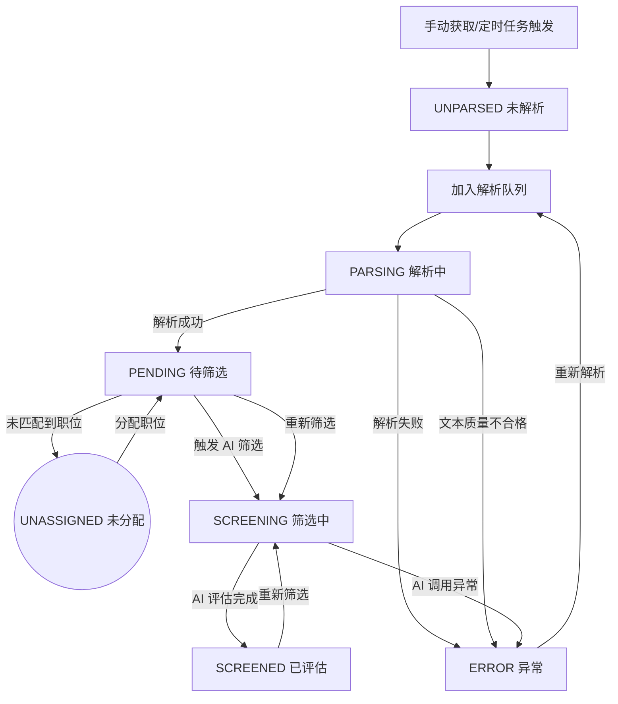

# 简历状态流转图

## 状态定义

### 数据库状态（`Resume.status` 字段）

| 状态值      | 中文名称 | 说明                                                |
| ----------- | -------- | --------------------------------------------------- |
| `UNPARSED`  | 未解析   | 邮件附件刚入库，等待解析                            |
| `PARSING`   | 解析中   | 正在进行文本提取，中间过渡态                        |
| `PENDING`   | 待筛选   | 已解析完成，等待 AI 筛选                            |
| `SCREENING` | 筛选中   | AI 正在进行筛选，中间过渡态                         |
| `SCREENED`  | 已评估   | AI 评估完成，结果写入 PositionEvaluation            |
| `ERROR`     | 异常     | 解析失败、文本质量不合格或 AI 筛选过程中发生错误    |

### 前端展示状态（非数据库值，由业务逻辑衍生）

| 状态值       | 中文名称 | 说明                                                    |
| ------------ | -------- | ------------------------------------------------------- |
| `UNASSIGNED` | 未分配   | `positionId IS NULL` 的简历，无论其 DB status 是什么    |

> **UNASSIGNED 说明**：不是 `Resume.status` 的实际值，而是前端根据 `positionId IS NULL` 衍生出的展示状态。简历列表页有独立的「未分配」Tab（`activeTab === 'unassigned'`），API 层将 `positionId=UNASSIGNED` 翻译为 `positionId: null` 查询。这些简历在数据库中的实际 status 通常是 `PENDING`（解析成功但未匹配到职位），少数可能是 `UNPARSED`。

> **已删除的数据库状态值**（旧版本使用，迁移后不再有效）：
> - `PARSED` — 已合并到 `PENDING`（解析成功后统一为 `PENDING`，通过 `positionId` 是否为空区分有无岗位）
> - `PASSED` — 已合并到 `SCREENED`（评估是否通过看 `PositionEvaluation.initialScore`）
> - `FAILED` — 已合并到 `SCREENED`（同上，SCREENED 不区分通过/未通过）

---

## 状态流转图（Mermaid）



> **图例**：方框 = 数据库 status 值，双层框 `(( ))` = 前端展示状态（非数据库值）

> **关键变更**（相比旧版本）：
> 1. 不再区分 `PARSED` 和 `PENDING` — 解析成功后统一进入 `PENDING`
> 2. `UNASSIGNED` 是前端衍生状态：DB status 为 `PENDING` + `positionId IS NULL` → 前端展示为"未分配"
> 3. 不再区分 `PASSED` 和 `FAILED` — AI 评估后统一为 `SCREENED`，具体结果看 `PositionEvaluation` 的得分
> 4. AI 评估结果写入 `PositionEvaluation` 表（替代旧的 `ScreeningResult`），支持同一简历对多个岗位产生独立评估

---

## 自动处理流程

### 定时任务自动流程

**触发方式：** 定时任务（周一至周五 9:30-18:00，每 30 分钟）或手动触发 `POST /api/cron/scheduler {"action": "run"}`

```
定时触发
    │
    ▼
获取邮件 (fetchEmails)
    │
    ▼
创建任务批次 (TaskBatch)
    │
    ▼
有新简历？
    │
    ├── 是 → 加入解析队列 (autoExtract=true, autoScreen=true)
    │           │
    │           ▼
    │        解析文本 (UNPARSED → PARSING)
    │           │
    │           ├── 失败/质量不合格 → ERROR
    │           │
    │           ▼
    │        自动匹配职位
    │           │
    │           ├── 匹配成功 → 设置 positionId，状态 PENDING
    │           └── 未匹配 → positionId 为空，状态 PENDING
    │                       （前端列表页展示为 UNASSIGNED）
    │           │
    │           ▼
    │        结构化数据提取 (AI)
    │           │
    │           ▼
    │        加入筛选队列（仅 positionId 不为空时）
    │           │
    │           ▼
    │        AI 筛选 (PENDING → SCREENING)
    │           │
    │           └── 评估完成 → SCREENED
    │                （结果写入 PositionEvaluation）
    │
    └── 否 → 结束
```

### Dashboard 手动获取流程

**触发方式：** `POST /api/emails/fetch` (autoProcess=true)

流程与定时任务相同，获取后自动进入解析 → 筛选流水线。

---

## 详细流转说明

### 1. 邮件获取与入库

**触发文件：** `lib/services/email-fetcher.ts`

**触发方式：**
- 手动获取：用户点击"手动获取"按钮
- 定时任务：工作日 9:30-18:00，每 30 分钟自动执行

**处理流程：**
1. 通过 IMAP 协议连接邮箱
2. 获取邮件附件（支持 `.pdf` / `.docx` / `.doc` / `.jpg` / `.png`）
3. 保存附件到本地 `data/uploads/` 目录
4. 创建简历记录，初始状态为 `UNPARSED`
5. 创建 `TaskBatch` 记录，用于追踪批次进度

### 2. 解析处理

**触发文件：** `lib/services/parsing-worker-processor.ts`

解析队列处理流程：

1. **开始解析**：状态更新为 `PARSING`
2. **文本提取**：调用 `parseResume()` 进行 3 级降级提取（直接提取 → OCR → AI Vision）
3. **解析失败**：状态更新为 `ERROR`
4. **文本质量门禁**：
   - 质量得分 < 40 或 文本长度 < 50 字符 或 乱码 → `ERROR`
5. **自动匹配职位**：根据文件名和邮件主题匹配职位
   - 匹配成功：设置 `positionId`
   - 未匹配：`positionId` 为空（状态仍为 `PENDING`，后续手动分配）
6. **状态更新为 `PENDING`**（解析成功后统一为此状态）
7. **自动结构化提取**（如果 autoExtract=true）：调用 AI 提取结构化数据
8. **自动加入筛选队列**（如果 autoScreen=true 且有 `positionId`）：加入筛选队列
9. **更新批次进度**：更新关联的 `TaskBatch` 统计数据

### 3. 分配职位

**触发文件：** `app/api/resumes/[id]/assign/route.ts`

- 为简历设置 `positionId`
- 分配职位不改变 `Resume.status`（DB 状态不变）
- **前端效果**：简历从「未分配」Tab（UNASSIGNED）移至「全部」Tab（根据其实际 status 显示）
- 分配后若有 `positionId`，简历可被加入筛选队列

### 4. AI 筛选

**触发文件：** `lib/services/screening-queue.ts` → `lib/services/ai-screener.ts`

- 前置校验：`extractedText` 必须存在且状态不为 `ERROR`
- 筛选开始：状态立即变为 `SCREENING`
- AI 调用返回后：
  - **成功**：创建/更新 `PositionEvaluation` 记录，状态变为 `SCREENED`
  - **失败**：状态变为 `ERROR`
- AI 评估写入 `PositionEvaluation` 的内容：
  - `summary`（评估摘要）、`strengths`（优势）、`weaknesses`（劣势）
  - `initialScore`（初筛得分，0-100）
  - `aiTags`（AI 标签）、`aiModel`、`tokenUsage`、`processingTime`
  - 2 条 `EvaluationDimension` 记录（knowledge + skill，source: "ai"）
  - 调用 `autoCalculateScores()` 计算 initialScore 和 compositeScore
- 不再区分 PASS/FAIL/UNCERTAIN，统一为 SCREENED，得分通过 `PositionEvaluation.initialScore` 体现
- 筛选完成后更新关联的 `TaskBatch` 统计数据

### 5. 重新解析

**触发文件：** `app/api/resumes/[id]/reparse/route.ts`

- 支持 `force` 参数
- `force = false`（默认）：仅当当前状态为 `ERROR` 或 `UNPARSED` 时，重新加入解析队列（状态变为 `UNPARSED`）
- `force = true`：无论当前状态，强制重新加入解析队列
- 加入队列后，自动进入 `PARSING` 状态进行解析
- 解析完成后，状态更新为 `PENDING`

---

## 状态流转汇总表

| 触发操作           | 当前状态                    | 目标状态    | 条件                       |
| ------------------ | --------------------------- | ----------- | -------------------------- |
| 手动获取/定时任务  | —                           | `UNPARSED`  | 通过 IMAP 获取邮件附件入库 |
| 开始解析           | `UNPARSED`                  | `PARSING`   | 加入解析队列               |
| 解析失败           | `PARSING`                   | `ERROR`     | 解析异常                   |
| 文本质量不合格     | `PARSING`                   | `ERROR`     | 质量得分 < 40 或 长度 < 50 |
| 解析成功           | `PARSING`                   | `PENDING`   | 文本提取成功               |
| 分配职位           | positionId 为空             | 不变        | 设置 positionId，前端不再展示为 UNASSIGNED |
| 触发 AI 筛选       | `PENDING` / `SCREENED`      | `SCREENING` | 筛选开始                   |
| AI 评估完成        | `SCREENING`                 | `SCREENED`  | 结果写入 PositionEvaluation |
| AI 筛选异常        | `SCREENING`                 | `ERROR`     | 调用 AI 失败               |
| 重新解析           | `ERROR` / `UNPARSED`       | `UNPARSED`  | 重新加入解析队列           |
| 强制重新解析       | 任意状态                    | `UNPARSED`  | force=true，重新加入队列   |

---

## 任务批次机制

### 批次创建时机

每次邮件获取（定时任务或手动触发）都会创建一个 `TaskBatch` 记录：

- **定时任务**：`source = 'scheduled'`，`sourceDetail` 包含执行时间
- **手动获取**：`source = 'manual'`
- **批量筛选**：`source = 'rescreen'`
- **复用评估**：`source = 'reevaluate'`

### 批次进度追踪

`TaskBatch` 记录以下统计数据：

| 字段              | 说明                                                    |
| ----------------- | ------------------------------------------------------- |
| `totalResumes`    | 批次中的总简历数                                        |
| `parsedCount`     | 已解析数量（状态为 PENDING/SCREENING/SCREENED）         |
| `screenedCount`   | 已筛选数量（状态为 SCREENED）                           |
| `errorCount`      | 失败数量（状态为 ERROR）                                |
| `screenErrorCount` | 筛选异常数                                              |
| `status`          | 批次状态：processing / completed / error                |

### 批次状态计算

- **processing**：仍有简历在处理中
- **completed**：所有简历处理完成，无错误
- **error**：所有简历处理完成，但有错误

### 进度更新时机

- 解析队列处理完每个简历后
- 筛选队列处理完每个简历后
- 查询批次详情时自动刷新

---

## 相关文件索引

| 文件                                        | 用途                            |
| ------------------------------------------- | ------------------------------- |
| `lib/services/email-fetcher.ts`             | 邮件抓取，创建 UNPARSED 记录    |
| `lib/services/resume-parsing-queue.ts`      | 解析队列管理                    |
| `lib/services/parsing-worker-processor.ts`  | 解析队列 Worker 处理逻辑        |
| `lib/services/screening-queue.ts`           | 筛选队列管理                    |
| `lib/services/ai-screener.ts`               | AI 筛选实现（写入 PositionEvaluation） |
| `lib/services/task-batch-service.ts`        | 任务批次服务                    |
| `lib/services/evaluation-service.ts`        | 评估维度 CRUD 和分数计算        |
| `app/api/resumes/[id]/assign/route.ts`      | 分配职位                        |
| `app/api/resumes/[id]/reparse/route.ts`     | 重新解析                        |
| `app/api/resumes/[id]/screen/route.ts`      | 手动触发筛选                    |
| `app/api/emails/fetch/route.ts`             | 手动获取邮件                    |
| `app/api/task-batches/route.ts`             | 批次列表 API                    |
| `app/api/task-batches/[id]/route.ts`        | 批次详情 API                    |
| `scripts/migrate-to-position-evaluation.ts` | ScreeningResult → PositionEvaluation 迁移脚本 |
