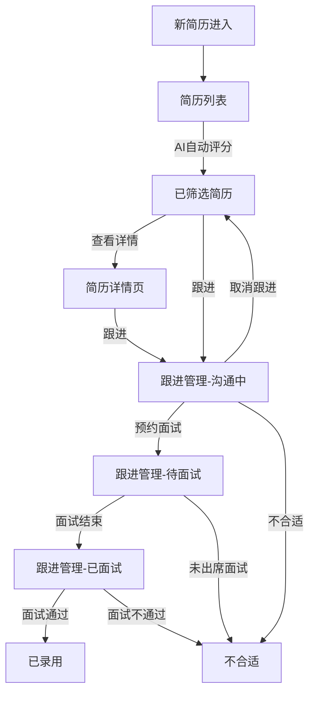

# 冰山模型评估体系需求

## 一、需求背景

当前招聘评估体系主要依赖AI对简历的筛选评分，但这种方式只能评估候选人的显性能力（知识、技能），无法全面评估候选人的隐性特质（自我认知、品质、价值观、动机等）。为了更全面、系统地评估候选人，需要引入冰山模型，建立多维度评估体系，支撑HR进行更科学的人才选拔决策。

## 二、为什么需要做这个改动

### 1. 单一维度评估不够全面
现有的AI筛选仅能评估简历中体现的知识和技能，无法评估候选人的软素质，导致招聘决策不够科学。

### 2. 评估标准需要规范化
不同HR对候选人的评估标准不一致，需要建立统一、体系化的评估框架。

### 3. 二面环节需要参考依据
面试官在二面时需要一份结构化的评估报告，以便快速了解候选人的综合情况。

### 4. 评估结果需要可量化
需要将各维度评估结果量化，便于对比和决策。

## 三、我们要改成什么样

### 1. 冰山模型维度划分

| 维度名称 | 评估来源 | 
|---------|---------|
| 知识 | HR人工评估（基于简历内容） | 
| 技能 | HR人工评估（基于简历内容） |
| 自我认知 | HR人工评估（基于面试表现） | 
| 品质特质 | HR人工评估（基于面试表现） | 
| 价值观 | HR人工评估（基于面试表现） |
| 动机 | HR人工评估（基于面试表现） |

### 2. 各维度定义说明

- **知识**：在学习和实践中获得的认知和经验，如行业知识、专业理论等
- **技能**：完成某项工作所需的具体能力，如编程技能、沟通能力等
- **自我认知**：对自己的了解和定位，包括自我觉察、自信心等
- **品质特质**：个人稳定的行为特征，如诚实、乐观、责任心等
- **价值观**：个人对事物是非曲直的判断标准，如合作精神、奉献精神等
- **动机**：内在的自然而持续的想法和偏好，如成就需求、人际交往需求等

### 3. 评分规则

- **单项评分**：每个维度采用5星级评分（🌟1星-🌟🌟🌟🌟🌟5星），对应1-5分
- **维度权重**：通过权重模型管理页面配置多个权重模型，各维度权重总和需为100%；列表中统一显示默认模型的评价结果，简历详情页可查看不同权重模型的结果差异
- **维度得分计算**：维度得分 = 星级评分值 × (该模型该维度权重/5)，其中倍数 = 权重占比 ÷ 5
  - 例如：某模型知识维度权重20%，倍数 = 20 ÷ 5 = 4，评分为4星，则维度得分 = 4 × 4 = 16分

### 4. 权重模型管理

**权重模型概念**：将评估维度的权重配置保存为可复用的模型，按评估阶段分为两大类；列表中统一使用默认模型计算评分，简历详情页可切换查看不同模型的结果差异，用于候选人内部横向对比。

**模型分类**：

| 分类 | 包含维度 | 适用场景 | 选择位置 |
|-----|---------|---------|---------|
| **初筛模型** | 知识、技能（仅2个维度） | 简历筛选阶段 | 简历详情页 |
| **冰山模型** | 知识、技能、自我认知、品质特质、价值观、动机（完整6个维度） | 面试后完整评估 | 简历详情页 |

**默认权重模型**：

| 模型名称 | 分类 | 包含维度 | 维度权重配置 | 适用场景 |
|---------|-----|---------|-------------|---------|
| **初筛-默认模型** | 初筛模型 | 知识、技能 | 知识50%、技能50% | 已筛选简历、沟通中、待面试列表 |
| **冰山-默认模型** | 冰山模型 | 知识、技能、自我认知、品质特质、价值观、动机 | 知识15%、技能15%、自我认知20%、品质特质20%、价值观15%、动机15% | 待面试列表、已面试列表 |

> **说明**：
> - 初筛模型仅包含知识和技能两个维度，权重总和为100%，用于简历筛选阶段
> - 冰山模型包含完整6个维度，权重总和为100%，用于面试后完整评估
> - HR可在权重模型管理页面创建、编辑、删除权重模型，需指定模型分类
> - 列表中统一使用默认模型计算评分，各列表页面不支持权重模型更换
> - 简历详情页可切换查看不同权重模型的结果差异，用于候选人自身对比

### 5. 两种得分概念

由于评估分两个阶段进行，系统存在两种得分：

| 得分类型 | 计算方式 | 满分 | 适用场景 | 适用列表 | 权重模型分类 |
|---------|---------|-----|---------|---------|-------------|
| **初筛得分** | 知识维度得分 + 技能维度得分 | 100分（百分制） | 简历筛选阶段，初步判断候选人是否值得跟进 | 已筛选简历、沟通中、待面试 | 初筛模型 |
| **综合得分** | 所有6个维度得分之和 | 100分（百分制） | 面试评估 | 待面试、已面试 | 冰山模型 |

> **说明**：
> - 初筛得分仅包含HR人工评估的"知识"和"技能"两个维度，使用初筛模型计算，满分100分
> - 综合得分包含完整的6个维度评估，使用冰山模型计算，满分100分
> - **数据层面**：一个评估结果记录在同一张数据表中，可在各列表间流转
> - **知识和技能维度**：默认沿用初筛阶段的评分，但可在任何阶段人工调整；修改后的值在所有关联列表中生效（共享同一数据字段）
> - 初筛阶段选择的初筛模型仅影响初筛得分计算
> - 面试阶段选择的冰山模型仅影响综合得分计算

## 四、页面结构设计

### 招聘中心页面布局

| 页面/模块 | 说明 | 状态管理 |
|---------|------|---------|
| **简历列表** | 显示所有简历，主要用于技术人员查看和检查 | 显示全部简历 |
| **已筛选简历** | HR评分和筛选的主要页面，显示已创建评估的简历 | 显示已评估的简历 |
| **跟进管理** | 三个子页面：沟通中、待面试、已面试 | 按状态流转 |

### 页面关系图

## 五、页面详细设计

### 1. 简历列表页面

**页面说明**：展示所有新收到的简历，主要用于技术人员查看和检查简历数据。AI会自动对简历进行评分，评分完成后自动进入已筛选简历列表。

**列表展示内容**：
- 候选人基本信息（姓名、电话、邮箱）
- 投递时间
- 来源渠道

**功能说明**：
- 移除"解析"按钮：简历自动解析，无需手动触发
- 移除"跟进"按钮：简历需先经过AI评分进入已筛选简历列表后才能进行跟进操作
- 移除"状态"列（通过/不通过）：该评判标准已不再使用

### 2. 已筛选简历页面

**页面说明**：HR评分和筛选的主要页面，显示已创建评估的简历，支持评分和结果自动更新。

**列表展示内容**：
- 候选人基本信息（姓名、电话、邮箱）
- **评分信息**：知识维度星级评分（🌟1星-🌟🌟🌟🌟🌟5星）、技能维度星级评分（🌟1星-🌟🌟🌟🌟🌟5星）、初筛得分（百分制，0-100分）
- **评分修改**：点击星级评分可直接修改，修改后自动重新计算初筛得分
- 评估时间
- 职位名称

**操作按钮**：
- "查看详情"：进入简历详情页，查看完整评估结果和可视化展示
- "跟进"：转入跟进管理-沟通中状态

### 3. 简历详情页

**页面说明**：整合评估结果展示，不再单独设置"AI分析结果"页面；支持选择不同职位查看对应评估结果，左侧展示能力维度可视化图表，右侧展示权重模型选择和实时得分计算。

**页面布局**：
- **顶部区域**：职位选择区域
- **左侧区域**：能力维度可视化区域（六边形雷达图）
- **右侧区域**：权重模型选择和得分计算区域

**顶部 - 职位选择区域**：

当一份简历投递了多个职位时，支持切换查看不同职位的评估结果：
- 下拉选择框：显示该简历投递的所有职位列表
- 当前选中职位名称高亮显示
- 切换职位后，评估结果区域（可视化图表、权重模型、得分计算）实时更新为对应职位的评估数据
- 若简历仅投递了一个职位，则不显示选择框，直接展示该职位名称

**左侧 - 能力维度可视化区域**：

统一使用六边形雷达图展示，**知识和技能维度位于相邻顶点**。

**可视化图表特性**：
- **实时更新**：评分修改后图表自动刷新
- **维度标签**：显示各维度名称和星级评分（🌟1星-🌟🌟🌟🌟🌟5星）
- **颜色区分**：已评分维度显示实际颜色，未评分维度不显示评分
- **交互评分**：点击维度顶点或标签可弹出星级评分组件进行修改

**评分权限控制**：

根据进入简历详情页的来源列表，控制不同维度的评分权限：

| 来源列表 | 知识维度 | 技能维度 | 自我认知 | 品质特质 | 价值观 | 动机 |
|---------|---------|---------|---------|---------|-------|-----|
| 已筛选简历 | ✅ 可修改 | ✅ 可修改 | ❌ 只读 | ❌ 只读 | ❌ 只读 | ❌ 只读 |
| 跟进管理-沟通中 | ✅ 可修改 | ✅ 可修改 | ❌ 只读 | ❌ 只读 | ❌ 只读 | ❌ 只读 |
| 跟进管理-待面试 | ✅ 可修改 | ✅ 可修改 | ✅ 可修改 | ✅ 可修改 | ✅ 可修改 | ✅ 可修改 |
| 跟进管理-已面试 | ✅ 可修改 | ✅ 可修改 | ✅ 可修改 | ✅ 可修改 | ✅ 可修改 | ✅ 可修改 |

> **说明**：
> - 只读维度显示灰色星级图标，点击无响应
> - 可修改维度显示彩色星级图标，点击弹出评分组件
> - 每个维度支持添加文本评价（备注说明）

**维度文本评价**：

每个维度在设置星级评分的同时，可添加一段文本评价（备注说明），用于记录评分依据或具体评价内容：
- 文本评价输入框位于星级评分组件下方
- 支持富文本或纯文本输入
- 最大输入长度：500字符
- 文本评价与星级评分一同保存

**右侧 - 权重模型选择和得分计算区域**：

**权重模型选择**：
- 下拉选择框：显示所有可用的权重模型（按分类分组）
- 当前选中模型名称高亮显示
- 切换模型后实时重新计算得分

**得分计算展示**：
- 显示当前选中模型的各维度权重配置
- 显示每个维度的得分（维度得分 = 星级评分 × 权重倍数）
- 实时显示总分（百分制，0-100分）
- 显示评分修改时间

**页面操作按钮**：
- "跟进"：转入跟进管理-沟通中状态

### 4. 跟进管理页面

**页面说明**：包含三个子页面（标签页形式），管理不同阶段的候选人。

**页面顶部统计信息**：
- 显示各阶段候选人数量
- 示例：沟通中 (8) | 待面试 (12) | 已面试 (5)

#### 4.1 沟通中子页面

**列表展示内容**：
- 候选人基本信息（姓名、电话、邮箱）
- **评分信息**：知识维度星级评分（🌟1星-🌟🌟🌟🌟🌟5星）、技能维度星级评分（🌟1星-🌟🌟🌟🌟🌟5星）、初筛得分（百分制，0-100分）
- **评分修改**：点击星级评分可直接修改，修改后自动重新计算初筛得分，使用默认的初筛模型计算
- 职位名称

**操作按钮**：
- "查看详情"：进入简历详情页
- "预约面试"：转入待面试
- "不合适"：在候选人拒绝等情况下使用，标记为不合适状态
- "取消跟进"：返回已筛选简历

#### 4.2 待面试子页面

**列表展示内容**：
- 候选人基本信息（姓名、电话、邮箱）
- **评分信息**：知识维度星级评分（🌟1星-🌟🌟🌟🌟🌟5星）、技能维度星级评分（🌟1星-🌟🌟🌟🌟🌟5星）、初筛得分（百分制，0-100分）
- **评分修改**：点击星级评分可直接修改，修改后自动重新计算初筛得分
- 面试时间
- 职位名称
- **标签**：可手动输入，也可选择预设标签

**模型自动选择**：
- 根据已填写的评估维度自动选择权重模型：
  - 仅知识、技能维度有评分：使用初筛模型，显示初筛得分
  - 6个维度均有评分：使用冰山模型，显示综合得分

**操作按钮**：
- "查看详情"：进入简历详情页，可以修改评分（6 个维度）和文本评价
- "面试结束"：转入已面试状态
- "未出席面试"：标记为不合适状态

#### 4.3 已面试子页面

**列表展示内容**：
- 候选人基本信息（姓名、电话、邮箱）
- **评分信息**：6个维度星级评分（知识、技能、自我认知、品质特质、价值观、动机，🌟1星-🌟🌟🌟🌟🌟5星）、综合得分（百分制，0-100分）
- **评分修改**：点击星级评分可直接修改，修改后自动重新计算综合得分
- 面试时间
- 职位名称
- **标签**：可手动输入，也可选择预设标签

**评估结论操作**：
- "录取"：标记为已录用，需填写录用相关信息（薪资范围、入职时间、岗位级别）
- "拒绝"：标记为不合适，需填写拒绝原因
- "查看详情"：进入简历详情页

### 5. 权重模型管理页面

**页面说明**：统一管理评估维度的权重配置，按分类管理初筛模型和冰山模型，支持创建、编辑、删除权重模型。

**页面功能**：
- 显示所有已创建的权重模型列表（模型名称、分类、包含维度、创建时间）
- 提供"创建新模型"按钮
- 支持编辑、删除已有的权重模型
- 预设两个默认模型：初筛-默认模型、冰山-默认模型

**新建/编辑模型弹窗**：
- 输入模型名称
- 选择模型分类（初筛模型/冰山模型）：
  - 选择"初筛模型"：自动锁定知识、技能两个维度
  - 选择"冰山模型"：自动锁定完整6个维度
- 为每个维度设置权重（输入框，支持1-100的整数）
- 实时显示权重总和，确保总和为100%
- 提供"保存"和"取消"按钮

## 六、核心优势

1. **AI自动评分**：新简历进入后AI自动评分，评分完成后自动进入已筛选简历列表
2. **整合评估展示**：简历详情页整合评估结果，左侧可视化图表，右侧权重模型选择和得分计算
3. **灵活的状态流转**：支持从任何状态返回重新处理
4. **横向对比分析**：简历详情页可切换不同权重模型，查看结果差异

## 八、验收标准

### 权重模型管理验收标准

1. 系统预设两个默认权重模型：初筛-默认模型、冰山-默认模型
2. HR可在权重模型管理页面创建、编辑、删除权重模型，需指定模型分类（初筛模型/冰山模型）
3. 创建/编辑模型时，权重总和必须为100%才能保存
4. 选择"初筛模型"分类时，自动锁定知识、技能两个维度
5. 选择"冰山模型"分类时，自动锁定完整6个维度
6. 列表中统一使用默认模型计算评分，各列表页面不支持权重模型更换
7. 简历详情页可切换查看不同权重模型的结果差异，用于候选人内部横向对比

### 简历列表验收标准

8. 新简历进入系统后自动显示在简历列表中
9. 简历列表展示所有简历
10. 简历列表移除"解析"按钮：简历自动解析，无需手动触发
11. 简历列表移除"跟进"按钮：简历需先经过AI评分进入已筛选简历列表后才能进行跟进操作
12. 简历列表移除"状态"列（通过/不通过）：该评判标准已不再使用
13. AI自动对简历进行评分，评分完成后自动进入已筛选简历列表

### 已筛选简历验收标准

14. 已筛选简历页面展示所有已完成AI评分的简历
15. 已筛选简历页面显示知识、技能维度星级评分（🌟1星-🌟🌟🌟🌟🌟5星）和初筛得分（百分制，0-100分）
16. 点击星级评分可直接修改，修改后自动重新计算初筛得分
17. 已筛选简历页面支持"查看详情"和"跟进"操作
18. 点击"跟进"后，候选人转入跟进管理-沟通中状态

### 简历详情页验收标准

19. 简历详情页整合评估结果展示，顶部职位选择区域，左侧能力维度可视化区域，右侧权重模型选择和得分计算区域
20. 统一使用六边形雷达图展示能力维度，知识和技能维度位于相邻顶点
21. 可视化图表实时更新，已评分维度显示实际颜色，未评分维度不显示评分
22. 支持切换不同权重模型，切换后实时重新计算得分
23. 显示当前选中模型的各维度权重配置和每个维度的得分
24. 评分权限控制：从已筛选简历/沟通中列表进入时，仅知识和技能维度可修改，其余4个维度只读
25. 评分权限控制：从待面试/已面试列表进入时，所有6个维度均可修改
26. 只读维度显示灰色星级图标，点击无响应；可修改维度显示彩色星级图标，点击可弹出评分组件
27. 每个维度支持添加文本评价（备注说明星级评分组件下方星级评分组件下方，最大500字符）
28. 文本评价与星级评分一同保存，支持后续查看和修改
29. 支持职位选择功能：当简历投递多个职位时，显示下拉选择框供切换
30. 切换职位后，评估结果区域（可视化图表、权重模型、得分计算）实时更新为对应职位的评估数据
31. 若简历仅只有一个岗位的评估结果，不显示选择框，直接展示职位名称

### 跟进管理验收标准

32. 跟进管理包含三个子页面（沟通中、待面试、已面试），状态流转符合设计
33. **沟通中子页面**：显示知识、技能维度星级评分（🌟1星-🌟🌟🌟🌟🌟5星）和初筛得分（百分制，0-100分），支持修改评分并自动重新计算初筛得分
34. **待面试子页面**：显示知识、技能维度星级评分（🌟1星-🌟🌟🌟🌟🌟5星）和初筛得分（百分制，0-100分），支持修改评分并自动重新计算初筛得分
35. **待面试子页面模型自动选择**：根据已填写的评估维度自动选择权重模型，仅知识、技能维度有评分时使用初筛模型，6个维度均有评分时使用冰山模型
36. **待面试子页面操作**：点击"面试结束"按钮，候选人转入已面试状态；点击"未出席面试"，标记为不合适
37. **已面试子页面**：显示6个维度星级评分（🌟1星-🌟🌟🌟🌟🌟5星）和综合得分（百分制，0-100分），支持修改评分并自动重新计算综合得分
38. **已面试子页面评估结论**：支持"录取"和"拒绝"操作，录取需填写薪资范围、入职时间、岗位级别，拒绝需填写拒绝原因
39. 所有子页面支持"查看详情"操作，进入简历详情页
40. 所有列表中的评分修改后，系统自动重新计算相应的百分制得分（初筛得分或综合得分）
