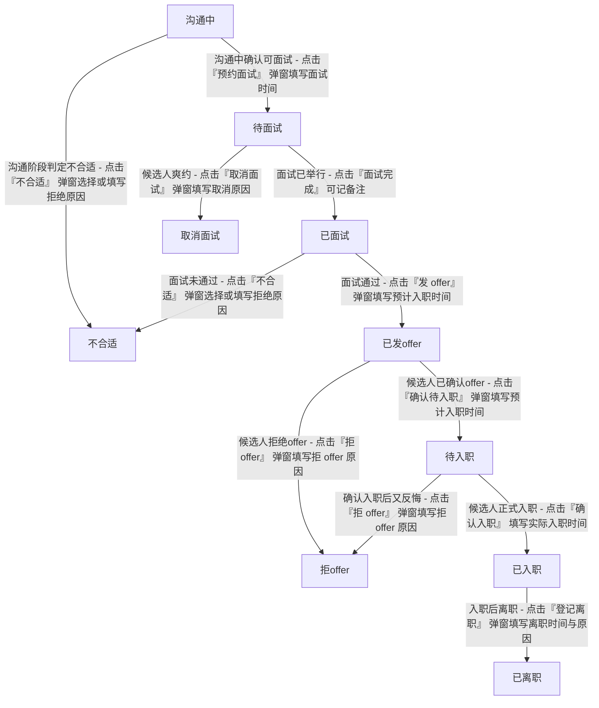

# 简历跟进状态梳理

## 一、需求背景

当前跟进状态仅有 **沟通中 / 待面试 / 已面试 / 已录用 / 已离职 / 不合适** 6 个，无法表达发 offer、拒 offer、取消面试等细分场景，且缺少误操作回退机制。本梳理旨在：

1. 拆分细化状态，明确每个阶段的语义与必填信息
2. 关键节点（发 offer / 入职 / 离职）强制填写对应字段，便于追溯
3. 增加统一的回退机制，应对误操作场景

---

## 二、状态总览（共 10 个）

| 状态名 | 说明 |
|---|---|
| 沟通中 | 初次接触，正在跟进 |
| 待面试 | 等待安排面试 |
| 已面试 | 面试完成，等待结果 |
| 已发offer | 已发出 offer，等待候选人回复 |
| 待入职 | 候选人已确认，等待入职日期 |
| 已入职 | 候选人已入职（原"已录用"） |
| 已离职 | 候选人入职后又离职 |
| 拒offer | 候选人拒绝 offer |
| 取消面试 | 候选人或 HR 主动取消面试 |
| 不合适 | 筛选/跟进后判定不合适 |

## 三、状态流转图（正向流转 + 界面操作）

> 每条边上标注该流转在界面上**触发的按钮 / 弹窗操作**，格式：`切换原因 - 点击按钮 弹窗内容`。

## 四、操作清单（便于核对）

| 流转 | 界面按钮 | 切换原因 | 弹窗/表单内容 |
|---|---|---|---|
| 沟通中 → 待面试 | 预约面试 | 沟通中确认可面试 | 面试时间 |
| 沟通中 → 不合适 | 不合适 | 沟通阶段判定不合适 | 拒绝原因（预设+自定义） |
| 待面试 → 已面试 | 面试完成 | 面试已举行 | （无强制，可记备注） |
| 待面试 → 取消面试 | 取消面试 | 候选人爽约 / HR 取消 | 取消原因 |
| 已面试 → 已发offer | 发 offer | 面试通过 | 预计入职时间 |
| 已面试 → 不合适 | 不合适 | 面试未通过 | 拒绝原因 |
| 已发offer → 待入职 | 确认待入职 | 候选人已确认 offer | 预计入职时间 |
| 已发offer → 拒offer | 拒 offer | 候选人拒绝 offer | 拒 offer 原因 |
| 待入职 → 已入职 | 确认入职 | 候选人正式入职 | 实际入职时间 |
| 待入职 → 拒offer | 拒 offer | 确认入职后又反悔 | 拒 offer 原因 |
| 已入职 → 已离职 | 登记离职 | 入职后离职 | 离职时间 + 离职原因 |

## 五、容错回退

> 上一节"操作清单"对应**正向流转**（按业务推进顺序）；本节对应**容错回退**（应对误操作场景）。
> 为避免误操作造成数据错误，**任何状态都可以回退**。点击"回退"按钮后弹出选择列表，用户自己选择目标状态并确认，无需填写其他信息。

| 当前状态 | 触发按钮 | 可选回退状态 |
|---|---|---|
| 待面试 | 回退 | 沟通中 |
| 已面试 | 回退 | 待面试 |
| 已发offer | 回退 | 已面试 |
| 待入职 | 回退 | 已发offer |
| 已入职 | 回退 | 待入职 |
| 已离职 | 回退 | 已入职 |
| 拒offer | 回退 | 待入职、已发offer |
| 取消面试 | 回退 | 待面试 |
| 不合适 | 回退 | 已面试、沟通中 |
| 沟通中 | — | —（起点，无回退按钮） |

### 回退操作说明
点击"回退"按钮 → 弹出回退窗口（需完成两项动作）：
  - a. 选择**目标状态**（列出该状态允许回到的所有上游状态）
  - b. 填写**回退原因**（说明为何回退，便于审计）
点击确认 → 状态变更完成。
回退成功后，原状态对应的信息（如拒绝原因、离职时间）会被清空。

---

## 六、开发任务清单

> 以下为本次梳理需要落地的工作项，按业务模块划分。

### 1. 状态定义

- 把当前的 6 个状态扩展为 10 个：沟通中、待面试、已面试、已发 offer、待入职、已入职、已离职、拒 offer、取消面试、不合适
- "已录用"统一改为"已入职"
- 历史数据迁移：
  - "已录用"的记录统一归为"已入职"，中间环节（已发 offer / 待入职）允许留空，不强制补全
  - 不新增字段、保持现有字段存储
  - 已入职的历史候选人数量较少，可在系统层面手动补全信息（如 入职时间）
  - 借助回退功能支持保留的可逆性：如发现历史信息需要修正，通过"回退"回到对应状态再补录信息后走回正向流程

### 2. 状态流转

- 支持第四节"操作清单"列出的 11 种正向流转（如沟通中→待面试、已面试→已发 offer 等）
- 关键节点必须强制填写对应信息后才能切换：
  - 切到"待面试"前要确认面试时间
  - 切到"已发 offer"前要确认预计入职时间
  - 切到"已入职"前要确认实际入职日期
  - 切到"已离职"前要确认离职时间和离职原因
  - 切到"不合适 / 取消面试 / 拒 offer"前要确认拒绝原因

### 3. 容错回退

- 每个状态都提供一个"回退"按钮（沟通中无按钮）
- 点击回退后弹出窗口，需选择目标状态 + 填写**回退原因**两个动作才能确认变更
- 回退原因用于说明为何回退（如"误标记""信息填写错误""状态选错了"），便于事后审计
- 回退成功后，系统自动清空原状态对应的信息（如拒绝原因、离职时间等）
- 回退操作要记录在操作日志里（含回退原因），便于追溯

### 4. 列表内联修改

- 不是所有 Tab 都支持内联修改，不同字段只能在特定 Tab 修改：
  - 面试时间：仅在"待面试" Tab 可修改
  - 入职时间（包含预计入职时间与实际入职时间，统一一个存储字段）：仅在"已发 offer"和"待入职" Tab 可修改
  - 离职时间：仅在"已离职" Tab 可修改
- 离职时间的修改要触发**二次确认**（慎重操作）
- 面试时间、入职时间的修改为常规操作，无需二次确认
- 修改后要记录操作日志

### 5. 按钮与弹窗

- 在跟进列表和详情页，按当前状态动态展示对应的操作按钮（参照第四节"操作清单"中的"界面按钮"列）
- 点击按钮后弹出对应的弹窗，弹窗内的填写项参照第四节"操作清单"中的"弹窗/表单内容"列

### 6. 标签列（每个状态独立）

- 跟进页按状态拆分为独立 Tab，每个状态一个 Tab（例如：沟通中、待面试、已面试、已发 offer……）
- 每个 Tab 内的列表都有一列「标签」，用于给候选人添加自定义标签（如"高级""急招""Java"等）
- 「标签」列支持以下操作：
  - 选择已有标签（多选）
  - 输入新标签名并确认即视为新建标签，全局共享可见
  - 已选择的标签可随时移除
- 候选人跟进过程中产生的标签会保留在记录里，跟随该候选人在不同状态 Tab 下可见

### 7. 操作日志

- 所有状态变更（包括正向流转和回退）都要写入日志，记录：
  - 变更前的状态
  - 变更后的状态
  - 填写的关键信息（如面试时间、拒绝原因等）
  - 修改的备注信息
- 日志用于审计追溯和问题排查

### 8. 验收要点

- 11 个正向流转都能正常切换，关键节点的信息强制填写
- 9 条回退路径都能成功执行，回退后相关信息正确清空
- 列表页只允许在指定 Tab 修改对应时间（面试时间仅待面试、入职时间仅已发 offer 和待入职、离职时间仅已离职）
- 所有状态变更都能在操作日志中追溯